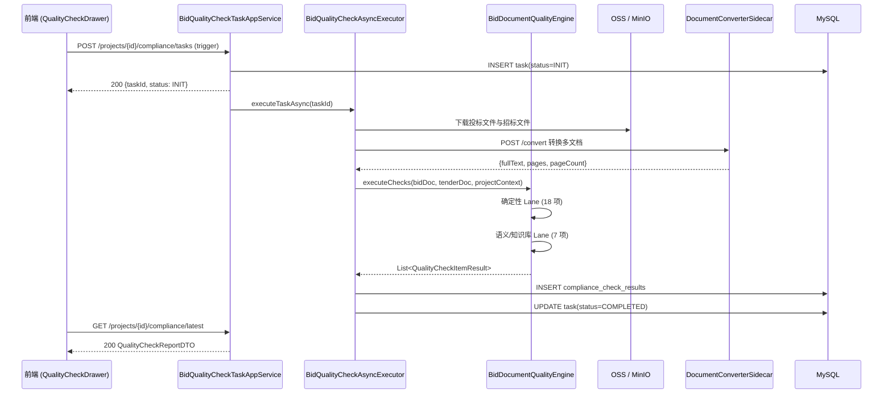

# 标书质量核查实质化架构（spec 049）

> spec 049 将标书质量核查从"固定文案证据 + page=1 硬编码"的验收失真状态实质化为全真实链路：真实投标文件 → 真实招标要求 → 四知识库真实查询 → 真实页码/原文定位 → LLM 混合裁决。旧同步链路已删除，唯一主线为异步任务链（trigger → 轮询 → 报告）。
> 核心目标：构建可溯源证据链（页码+原文切片）、严格区分系统判定与人工复核，杜绝假通过与假不通过。

## 1. 25 项检查项架构布局与数据流

25 项标准检查项（PRD 2.3）按核查实现手段划分为两条车道：
- **确定性 lane**（`DeterministicCheckPolicy`，18 项）：毫秒级规则核查，不依赖 LLM。
  - 基本信息（9 项）：封面要素（项目名/投标人/日期）、投标函格式规范（含《报价函》/《响应函》/公文称谓）、授权委托书（法定代表人+受托人）、营业执照（三证合一/统一代码）、报价一致性（大写转数值与小写绝对比对）、计价货币单位（人民币/元）、工期响应、签署盖章占位、联系人信息（含有效电话校验）。
  - 分项合规（4 项）：文件完整性（多册合并总页数 >= 3）、模板格式规范（DOCX/PDF 格式合规）、废标敏感词扫描（含否定词/承诺修饰语义反转识别）、承诺书签章规范。
  - 附件清单（5 项）：法定代表人身份证明、开标一览表、投标保证金凭证（免收标免除）、CA 证书有效性（非网标免除）、保证金退还账户信息（免收标免除）。
- **语义/知识库 lane**（`SemanticRulesLane`，7 项）：大模型语义比对 + 四知识库检索。
  - 四知识库联动：资质要求审查（对齐资质库三方比对基准）、业绩要求响应（案例库业绩特征提取与加权比对）、财务指标审查（财务数据提取）、实质性条款响应（负偏离判定）、服务方案与技术响应（方案契合度）、人员配置合规性（项目经理/技术负责人证书比对）、评分标准逐条应答（PRD 2.3 评分点提取与响应度打分）。

## 2. 真实数据流五步闭环



## 3. 证据链规范（QualityEvidence）

每一个检查项结果必须携带 `List<QualityEvidence>`，严禁空证据假判定：
- `BID_DOCUMENT`：标书原文证据，包含 sourceTitle（如"报价函章节"）、pageNumber（物理页码或虚拟块页码）、quote（原文摘录上下文）。
- `TENDER_REQUIREMENT`：招标文件条款证据，摘录招标方原始要求。
- `KNOWLEDGE_BASE`：企业知识库参考证据，包含 entityType（QUALIFICATION/CASE/FINANCIAL/STAFF）及 referenceId，支持前端一键跳转。

## 4. 关键陷阱与架构演进教训

1. **多文件合并与 Loader 边界**（2026-08-20）：真实项目投标文件分多册（价格/商务/技术）。多文件在 Loader 边界合并为单个逻辑 `DocumentContent`，页码采用全局连续编号，核查引擎零感知文件分裂。
2. **Sidecar 分页缺失与虚拟分页兜底**（2026-08-22）：Sidecar 对长 docx/pdf 转换的 markdown 经常缺失物理分页符 `\f`，整篇文本退化为单页导致页数判断与证据定位失真。引入 `DocumentContent.virtualPages` 标题与字符预算混合分块机制，恢复页码有效性。
3. **废标词反向修饰与正向承诺语境识别**（2026-08-25）：标书中常包含“我方承诺不发生任何串通投标、行贿等违法违规行为”，若直接正则匹配“串通投标”会造成假阳性误报。引入 `isNegatedOrCommitment` 窗口探测，消除误判。
4. **附件免收场景自适应通过**（2026-09-02）：招标文件若明确“免收投标保证金”或为线下纸质标无需 CA 锁，保证金与 CA 检查项自适应判定为 PASS 并提示“免收/不涉及”，防止机械阻断。
5. **异步任务中间进度独立事务即时提交**（2026-08-30）：长任务采用独立事务更新进度，避免顶层事务包裹导致前端轮询卡死。
6. **LLM 结构化输出解析三层防御**（2026-08-30）：JSON 括号配平提取 + 中文状态归一化 + 空结论兜底，消灭网关异常与解析报错暴露给用户。
7. **大模型语义 RAG 全文无损透传与自然页码重排**（2026-08-30）：废弃前缀硬截断，超预算采用 Top-N 语义打分筛选与页码顺序重排，保证中后段关键资质与方案对大模型可见。
8. **网关不支持 response_format 的原子降级标记**（2026-08-30）：`AtomicBoolean` 标记网关兼容性，首遇 400 立即降级并持久化状态，杜绝重复 400 网络惩罚。
9. **前端轮询超时放宽至 10 分钟与进行中状态隔离**（2026-08-31）：前端轮询超时放宽至 600s，抽屉在核查进行中不渲染旧报告，杜绝状态漂移与旧报告残留。
10. **谈判/非招采购场景《报价函》与公文称谓支持及抗目录干扰**（2026-09-03）：基本信息类核查「投标函格式规范」原先硬编码仅检索《投标函》与字面「致：」，在竞争性谈判、竞争性磋商、询价等法定使用《报价函》/《响应函》的采购场景中发生假阴性误报；同时关键词命中首页目录（TOC）超链接时，因目录页缺少实质称谓和正文承诺导致误判。修复扩充识别词表为包含投标函/报价函/响应函等多文书类型的 `BID_LETTER_KEYWORDS`，选页逻辑优先匹配同时具备称谓与承诺要素的实质正文章节页（跳过目录链接），称谓判定扩充支持 `（采购人名称）：` 等标准公文抬头与占位符规范。
11. **投标保证金两阶段结构化契约抽取与凭证事实要素校验**（2026-09-05）：旧判定在招标文件采用前附表 Markdown 表格形式免除保证金时失效，且标书首页目录（TOC）命中宽泛词“汇款凭证”造成假通过。重构为两阶段契约抽取：阶段一在招标文件提取结构化 `depositRequirement`（是否免收/金额/形式/依据），配合 `DeterministicDepositExtractor`（支持投标担保与中文大写金额）做硬事实交叉检验，防止 LLM 幻觉免收放大；若明确免收则硬信号直出 PASS 并联动第 25 项豁免；若需缴纳，标书端接通 `LlmAdjudicator` 深度裁决与 `SemanticPageRetriever` 候选页检索，且确定性初筛强制要求具备凭证类型与交易事实要素（银行流水号/收款人/印章等），坚决剔除目录点线与无要素口头声明。
12. **投标函格式规范结构化契约抽取与要素反假**（2026-09-05）：旧逻辑在仅命中目录页点线索引时，因回退逻辑缺陷退回返回目录页并误判为 MANUAL（‘已找到投标函，仅称谓不规范’），且无法对抗未填写的占位符模板（如【采购人名称】、下划线留白）及承诺有效期不足的合规风险。重构为：招标端扩展 `BidLetterRequirement` 契约（函件类型/采购人全称/有效期天数/原文章节），建立 `DeterministicBidLetterExtractor` 双轨融合；标书端 `findBestBidLetterPage` 与 `isActualBidLetterPage` 正向事实要素检验（严格拦截目录点线 `......` 与未填写占位符），并比对采购人称谓一致性与有效期天数；引擎落实规范正文强凭证直通 PASS（不调 LLM，防抖动与降本），未检索到或存疑场景接通 `LlmAdjudicator` 深度裁决。
  - _index
  - docinsight-engine
  - ai-provider-configuration
---
# 标书质量核查实质化架构（spec 049）

spec 049 将标书质量核查从"固定文案证据 + page=1 硬编码"的验收失真状态实质化为全真实链路：真实投标文件 → 真实招标要求 → 四知识库真实查询 → 真实页码/原文定位 → LLM 混合裁决。旧同步链路已删除，唯一主线为异步任务链（trigger → 轮询 → 报告）。

## 1. 唯一主线（五步真实数据流）

| 步骤 | 组件 | 产物 |
|------|------|------|
| 1 投标文件 | `ComplianceTargetLoader` + Sidecar 解析 | `DocumentContent`（分页 PageContent[]，真实 fileHash） |
| 2 招标要求 | `TenderRequirementsExtractor`（LLM 结构化提取） | `TenderRequirements`（硬性资质/评分项/否决条款；失败降级 `missing()` 哨兵不阻断） |
| 3 知识库 | `KnowledgeBaseOnDemandLoader` 四库按需查询 | `KnowledgeQueryOutcome`（`KnowledgeMatch` 列表 + `failedSources` 失败源） |
| 4 证据定位 | `EvidenceLocator` 关键词真实定位 | 命中=真页码+原文摘录；未命中 page=null+空 quote（**禁止填 1**） |
| 5 裁决 | `BidDocumentQualityEngine` 编排 | 25 项 PASS/FAIL/MANUAL_REVIEW + reasonCode |

## 2. 混合裁决架构（引擎三路与语义 RAG）

- **确定性 lane**（`DeterministicCheckPolicy`，18 项）：毫秒级规则核查，不依赖 LLM。
- **语义规则 lane**（`SemanticRulesLane`，7 项）：硬信号先行——资质匹配/否决条款/负偏离等可由规则直接裁决；无硬信号返回 empty 移交 LLM。
- **LLM 裁决 lane 与全标书语义 RAG**（`LlmAdjudicator` + `SemanticPageRetriever`）：只做语义项裁决层，**不做全量直出**；彻底废弃前缀硬截断（6000/4000 字符），改走全标书语义 RAG 检索与结构化输出通道：
  1. **语义页面检索（SemanticPageRetriever）**：纯领域核心（FP-Java 无依赖）。提取 7 项检查项静态线索（`addStaticItemCues`，如资质证书/偏离表/付款方式/审计报告等）与招标要求动态线索（`addDynamicRequirementsCues`），对 `DocumentContent.pages()` 进行相关性打分（标题匹配 +50、正文关键词 +10、词频 +2/次上限 20）。
  2. **大预算与全文透传**：投标文件默认预算 60,000 字符（>=60K 红线），招标文件默认预算 30,000 字符。若文档总字符量在预算内，100% 全文无损透传；超预算则选取得分最高的 TOP-N 页面，并按自然页码升序重新排序装配。
  3. **物理页码元数据保留**：上下文输出强制保留 `--- [第 X 页] ---` 物理页码标识，确保 AI 在生成裁决结论与证据引用时具备真实页码锚点。
  4. **结构化输出通道（chatCompletionJsonObject）**：通过 `AiProvider.chatCompletionJsonObject` 注入 `response_format: {"type": "json_object"}`，从协议层保证大模型输出标准 JSON 对象；网关不支持时通过 `AtomicBoolean` 单向原子降级并缓存，结合 `LlmVerdictParser` 容错提取与仅针对 `Invalid` 的 1 次追加严格约束重试，构成端到端四层防护。

## 3. 失败传导纪律（FP-Java 值返回）

通道一切失败在边界适配器（executor `buildLlmPort`）吸收为 `LlmVerdict.ChatOutcome` sealed 四值，纯核心无异常流：

| 通道结果 | 语义 | 单项处理 |
|----------|------|----------|
| `Success` | 调用成功且响应已解析 | 按 verdict 出 PASS/FAIL/MANUAL |
| `Invalid` | 响应不可解析（经 1 次重试后仍非法） | MANUAL + LOW_CONFIDENCE |
| `Noop` | AI 未启用（IllegalStateException） | MANUAL + MANUAL_REVIEW_REQUIRED，任务仍 COMPLETED |
| `Failure` | 调用异常/超时 | MANUAL + LOW_CONFIDENCE，不阻断整体 |

结构化调用通道的多层防御契约：
- **第一道防线**：`aiProvider.chatCompletionJsonObject`（`response_format: {"type": "json_object"}`），消除大部分格式漂移。
- **第二道防线**：网关 400 不支持时自动捕获，`responseFormatUnsupported` 原子标记置 true，平滑单向回退到普通 `chatCompletion`。
- **第三道防线**：`LlmVerdictParser` 在 service 边界层吸收 checked 异常，利用括号配平扫描提取首个 JSON 对象、归一化中英文状态并兜底空结论。
- **第四道防线**：`buildLlmPort` 仅对解析失败（`Invalid`）追加严格 JSON 约束重试 1 次（`Noop` / `Failure` 不重试），确保瞬态波动可自愈。
- **终极兜底**：纯核心生成用户可读文案（`FALLBACK_INVALID_CONCLUSION` / `FALLBACK_FAILURE_CONCLUSION`），任何异常路径均不向前端暴露技术堆栈。

reasonCode 五值（PRD §3.5）：EVIDENCE_INSUFFICIENT / AMBIGUOUS / LOW_CONFIDENCE / REFERENCE_MISSING / MANUAL_REVIEW_REQUIRED；MANUAL 态 conclusion 带 `[CODE] ` 前缀（`ManualReasons` 统一格式化）。知识库单库异常同理：记入 `failedSources` → 依赖该库的检查项 MANUAL + REFERENCE_MISSING。

## 4. 关键陷阱

1. **证据失真比无证据更危险**：固定文案/硬编码页码让验收误判功能完成。G5 门禁用 grep 零命中验收（固定文案 / `pageNumber, 1` / isDemoMode，见 quickstart §5）。
2. **switch 模式匹配触发 FP 门禁**：Java 21 对 sealed 接口的 switch 模式匹配编译产物含 `new MatchException`，被"纯核心禁止构造 Throwable"判据命中；纯核心分派用 instanceof 序贯链（`docs/lessons/lessons-learned.md §141`）。
3. **JSON 解析不进纯核心**：`LlmVerdictParser` 置 service 边界层（Jackson checked 异常），同 `TenderRequirementsParser` 先例。
4. **存储口径已定案**（G6，2026-08-20 产品确认）：PRD §4.4"不持久化 + Redis TTL"废弃，采纳方案 B——DB 保存 + 文件 hash 缓存 + force 重跑（spec §5.2，待下次 PRD 修订同步）。
5. **确定性 lane 误判修复**（2026-08-21 审查跟进）：`declaredDeviation` 的 `contains("负偏离")` 把"偏离表：无负偏离"（标准合规表述）误判 FAIL → 改三分支（否定前缀豁免 → PASS，未提及交 LLM）；`vetoFirstStage` 精确匹配 LLM 提取资格全文，空白/标点差异误判缺失 FAIL → 匹配前归一化（去空白/全半角/标点）。一票否决项（FAIL=废标级）禁止裸 contains 直出。
6. **规则 lane 含否定语义用紧邻前缀判断**：否定词（无/未/零/没有/不存在/不含/无任何）须落在关键词紧邻前缀（前 4 字符），避免"付款方式存在负偏离"（前缀"存在"）被误豁免。
7. **大文件与二进制降级禁止调用 Files.readString**：非纯文本格式（`.docx`/`.pdf`/`.zip`）或大文件（$>5\text{MB}$）本地降级时禁止调用 `Files.readString`（防 DirectBuffer 堆外 OOM），必须只计算哈希并返回空文本。
8. **超大 Docx 标书媒体前置过滤**：超过 20MB 的 `.docx` 标书在向 Sidecar 发送前由 `DocxMediaFilter` 流式滤除 `word/media/` 媒体流，请求体缩小 99%（1.66GB $\to$ 1.5MB），彻底消除 Sidecar 512MB 上传限制与网络传输超时（`specs/053-docx-media-stream-filter-fast-intake/`）。
9. **异步触发接口禁止长耗时同步 I/O**：`POST /api/compliance/bid-quality/trigger/{projectId}` 端点禁止在主线程同步加载与解析大文件（避免击穿前端 Axios 30s 超时阈值）；必须在 10ms 内完成元数据校验并入库返回 `taskId`，文档加载/Sidecar解析/LLM分析全部在异步线程完成。
10. **异步任务中间进度使用独立事务即时提交**：`BidQualityCheckProgressUpdater` 使用 `@Transactional(propagation = Propagation.REQUIRES_NEW)`，避免整个长任务被顶层大事务包裹导致中间进度更新滞留在缓冲区，确保前端轮询秒级感知 20%/60%/80% 真实进度。
11. **LLM 裁决响应解析三层防御**（2026-08-30）：模型常以 ```json 围栏包裹/JSON 前后加解释文字/返回中文状态（通过/待确认）/MANUAL 缺 conclusion，旧版 `readTree(原始响应)` 直接失败并把"响应结构非法"技术文案暴露给用户。修复分三层：① `LlmVerdictParser` 配平扫描提取首个 JSON 对象 + status 中文同义归一 + MANUAL 空结论兜底；② 边界适配器仅解析失败追加强约束重试 1 次（Noop/Failure 不重试）；③ 纯核心兜底结论用户可读（"AI 本次未能自动裁决该条款…已转人工确认"），任何路径都有有意义的检查结论。历史报告快照在 `toReportDTO` 按 itemCode 回填标准名称/说明（`withCanonicalDefinition`），无需数据迁移。
12. **LLM 裁决解析失败全链路可观测**（2026-08-30）：#11 的三层防御上线后，Invalid 路径一条日志都没有——解析失败与重试都是静默的，上线后若仍有解析失败将无从排查。补齐：`chatAndParse` 解析失败时 `log.warn` 原始响应（截断 500 字）；`buildLlmPort` 重试前 `log.warn`；重试契约由 `BidQualityCheckAsyncExecutorTest` 四个单测锁定（解析失败重试成功 / 重试后仍非法 Invalid / Noop 不重试 / Failure 不重试）。
13. **标书硬截断导致中后段关键内容对大模型不可见**（2026-08-30 架构重构）：旧版 `LlmAdjudicator.buildPrompt` 采用前缀硬截断（投标文件截断前 6000 字符、招标文件截断前 4000 字符），导致几十页上百页标书的技术方案、偏离表、项目业绩、财务报表、资质证书等分布在中后段的核心内容完全无法进入大模型上下文，大模型因缺乏依据大量降级为 MANUAL 待人工确认。解法：设计纯核心 `SemanticPageRetriever`，废弃 `substring` 硬截断；采用“大预算（>=60K 字符）+ 预算内全文无损透传 + 超预算 TOP-N 语义打分筛选 + 自然页码重新排序 + 保留 `--- [第 X 页] ---` 物理页码标识”的语义 RAG 机制，既保证长标书关键章节对 AI 100% 可见，又保留真实证据链定位能力。
14. **网关不支持 response_format=json_object 时的静默 400 与原子降级标记**（2026-08-30 结构化输出演进）：部分 OpenAI 兼容 API 网关或代理服务不支持 `response_format: {"type": "json_object"}` 参数，直接抛出 HTTP 400 Bad Request（如 "unrecognized field", "unsupported parameter response_format"）。若简单捕获重试，会导致每个请求都遭遇 400 失败并产生双倍网络往返延迟。解法：在 `OpenAiCompatibleClient` 中引入 `AtomicBoolean responseFormatUnsupported` 线程安全标记；在 `chatCompletionJsonObject` 捕获到参数不支持的 400 错误时，一次性将标记置为 `true` 并降级为普通 `chatCompletion`；后续所有请求直接走普通调用，彻底消除多余的 400 异常与额外延迟；同时下游保留 `LlmVerdictParser` 的 JSON 括号配平扫描作为兜底解析防线。
15. **异步线程池显式绑定与事务提交时序解耦**（2026-08-31 稳定性加固）：`@Async` 必须显式指定目标线程池 `@Async("aiTaskExecutor")`，杜绝多 Executor 容器下无 `@Primary` 导致的调度歧义以及在 CallerRunsPolicy 下同步占用 Tomcat 主请求线程导致的前端 30s 请求超时；同时 `triggerQualityCheck` 在 `save(taskEntity)` 后必须使用 `TransactionSynchronizationManager` 的 `afterCommit` 钩子安全触发异步流水线，消除主事务与 `BidQualityCheckProgressUpdater` 独立事务（`Propagation.REQUIRES_NEW`）之间的行可见性竞态。
16. **前端轮询超时放宽与未完成长任务状态隔离**（2026-08-31）：前端长耗时 AI 任务（含多轮 LLM 语义裁决）轮询上限必须 >= 10 分钟（`MAX_POLL_TIMEOUT_MS = 600000`），禁止设为 1~2 分钟导致任务在后台正常完成时前端误报超时；同时抽屉在 `loadLatestReport` 中对 `INIT`/`PARSING`/`CHECKING` 等进行中状态直接进入轮询而不给 `report.value` 赋值，重新核查（`force=true`）显式置空 `report.value = null`，彻底杜绝超时/失败时 UI 状态错乱与旧报告残留。
17. **正向履约承诺误判与附件免除项假通过治理**（2026-09-02）：废标敏感词扫描必须结合前置窗口识别否定/承诺修饰语境（`isNegatedOrCommitment`），杜绝将正向合规承诺/违约条款确认误判为违规反标；附件核查（保证金/CA/退还账户）必须前置解析招标文件适用性（免收/纸质标），对免除场景准确判定 PASS 并标注“免收/不涉及”，凭证核查必须匹配核心特征组合词，防止单字包含导致虚假通过；资质匹配说明文案对齐三方比对基准，未提取到要求时友好降级提示人工核验。
18. **资质匹配"0 匹配"根因与三级穿透及结构化比对清单**（2026-09-03）：
    - **反向包含假阴性消除**：`KnowledgeBaseOnDemandLoader` 旧版使用 `q.getName().contains(kw)`，将短证书名反向包含大模型提取的长句导致恒为 false（资质库 0 匹配）。重构为纯核心 `QualificationMatchPolicy`，实现双向包含、标准代号提取（`ISO9001/ISO27001/CMMI/ITSS` 等）、专有资质等级对齐与 LCS 判定，并在资质库与人员库统一复用。
    - **招标文件三级优雅回退**：`TenderDocumentLoader` 支持一级查 `project_documents` 标准 `TENDER` 分类；二级按文件名启发式识别项目文档；三级向上穿透回退到 `project -> tender.source_document_file_url`，彻底打通仅在标讯带入文件的立项场景。
    - **结构化比对清单透传与弹窗呈现**：新增 `QualificationDetail` 领域模型并集成到 `QualityCheckItemResult` 与报表 DTO，前端在 `QualityCheckDetailDialog.vue` 中渲染结构化比对表格（招标资质要求 vs 我司持有证书 vs 标书位置 vs 核查说明），并 100% 接入全局设计系统令牌。
19. **招标资格与资质要求"漏识别"根因与双轨融合架构**（2026-09-03）：
    - **公文强规范与常识性必然存在**：依据《招标投标法》第 18 条，任何招标文件必然包含资格要求章节。系统提示"未在招标文件中提取到明确的硬性资格要求"纯属系统提取缺陷，不可向用户暴露虚假的不存在。
    - **`TenderRequirementsParser` 代码块围栏容错**：大模型常用 ````json` 围栏包裹或附加前后说明文字，旧版 `OBJECT_MAPPER.readTree` 直接抛 checked 异常降级为 `missingSentinel`。通过引入 `extractJsonObject` 括号配平扫描，成功剥离围栏与对话文字，杜绝格式噪声引发的降级。
    - **确定性规则提取器（`DeterministicQualificationExtractor`）**：建立纯核心正则章节锚定与标号切分策略，自动识别专用资质（增值电信业务许可证、等保三级、ISO、安全生产等）与通用资格（法人资格、失信限制），过滤占位符（如 `人员要求：/`）。
    - **质检流水线双轨融合**：`BidQualityCheckAsyncExecutor` 将规则提取的确定性资格与 LLM 提取的资格并集去重（`withMergedQualifications`）。只要规则提取出资质，即可解除 `missing` 标记，确保资质比对与结构化清单 100% 稳定生成。
    - **代码去重与常数收敛（Anti-Slop 治理）**：`TenderRequirementsParser` 统一复用同包 `LlmVerdictParser.extractJsonObject` 配平扫描，消除 35 行重复实现；`DeterministicQualificationExtractor` 移除 `LinkedHashSet.add` 前多余的 `contains` 检查，并将证书特征词抽为不可变常量 `CERTIFICATE_CORE_KEYWORDS`；前端弹窗移除空包装函数 `qualStatusBadge`。
20. **企业资质库底层表纠偏与国字头前缀剥离穿透**（2026-09-04）：
    - **数据源对齐**：将 `KnowledgeBaseOnDemandLoader` 对接真实业务资质库 `BusinessQualificationRepository`（读取 `business_qualifications` 物理表 62 条有效资质，状态为 `IN_STOCK` 且 `retired = false`），彻底消除读取历史单数 `qualifications` 废弃空表导致的“资质库未维护该证书”虚假误报；
    - **行政前缀剥离**：在 `QualificationMatchPolicy` 建立 `GOV_PREFIX_RE` 正则（剥离“中华人民共和国/全国/中国/国家”等行政修饰前缀），支持核心法定证书名穿透包含，并扩充电信业务与互联网信息服务专有领域词表；标书页码检索 cues 同步引入核心证书名，实现标书页码精准定位。
21. **LCS 停用词收紧与多候选打分优先排序及章节导语清洗**（2026-09-04）：
    - **LCS 通用停用词阻断**：扩充 `STOP_WORDS`（纳入“经营许可证”、“许可证”、“业务经营许可证”、“生产许可证”、“中华人民共和国”、“管理体系认证”等），`isStopword` 优先保护 `DOMAIN_TERMS` 核心专有名词，对其余通用词严格拦截，彻底阻断仅因共享通用证件后缀而引发的跨类别错配（如增值电信错配医疗器械）；
    - **打分第一主键原则（Relevance-First）**：`findBestMatchingCert` 建立 `calculateMatchScore` 多级相关度打分（包含1000+ > 标准代码500+ > 行业专有名词200+ > LCS100+），匹配打分作为绝对第一排序键，有效期仅作为相同打分梯队内的决胜依据（Tie-breaker），杜绝有效期长的弱相关证书反超核心资质；
    - **章节导语与噪点过滤**：在 `DeterministicQualificationExtractor` 与 `TenderRequirements` 中引入 `isIntroductoryHeading` 结构化判断（过滤以冒号结尾或含“以下证书/下列条件”的导语段落，如 `2.1 资质要求：供应商应具有以下证书`），并强化前导 `;` 等标点符号清洗，确保比对清单 100% 纯净。
22. **专用资质证书与通用主体资格边界厘清与分流治理（方案 A）**（2026-09-04）：
    - **法理与业务本质划界**：基于《招标投标法》第 18 条与《政府采购法》第 22 条，区分“通用主体资格条件”（独立法人、民事责任能力、财务会计制度、无违法失信等）与“专用行业资质许可”（增值电信、安全生产、等保三级、ISO 认证等）；企业通用主体资格由《营业执照》及承诺函证明，由 Rule 4（营业执照审查）等确定性规则闭环；企业资质库（`business_qualifications`）仅维护专业许可证，无营业执照实体。
    - **提取端分类归一（`DeterministicQualificationExtractor`）**：建立 `SPECIFIC_CERTIFICATE_KEYWORDS` 与 `GENERAL_CAPACITY_KEYWORDS` 双轨识别体系；`extract` 仅返回专用行业资质证书，彻底过滤法人及信用等通用条款；同时提供 `extractGeneralCapacities` 供通用规则复用；
    - **领域模型与匹配策略纵深防御**：`TenderRequirements.sanitizeQualifications` 与 `QualificationMatchPolicy.buildDetails` 双重校验 `isSpecificCertificate`，即使大模型提取误包含法人条款，在进入领域模型与比对清单时即被净化过滤；从根源上杜绝了“用增值电信业务许可证证明企业是独立法人”的荒谬错配，以及通用条款因资质库未维护而误报废标风险的问题。
23. **投标函格式规范(BID_LETTER_FORMAT)两阶段结构化契约与要素反假重构**（2026-09-05）：
    - **两阶段结构化契约**：在 `TenderRequirements` 与 `BidQualityCheckItem` 中建立投标函格式专属检查契约，覆盖格式规范、金额、工期与质量标准的一致性；
    - **目录行与虚假占位模板拦截**：在 `BidLetterCheckPolicy` 建立点线目录扫描与虚假模板拦截，杜绝仅有目录或占位声明的虚假通过；
    - **确定性与 LLM 协同**：在非免除且缺乏确定性强凭证事实时，由 `BidDocumentQualityEngine` 调用 LLM 裁决并保留完整比对事实链。
24. **质检领域纯核心反 AI 异味（Anti-Slop）治理与代码消歧微重构**（2026-09-05）：
    - **逻辑去重与抽取**：`DeterministicBidLetterExtractor.parseDigitsSafely` 提为包级方法，`BidLetterCheckPolicy` 直接复用，彻底删除策略类内部 15 行重复解析数字逻辑；
    - **冗余子串条件折叠**：消除带书名号及后缀的冗余条件（如 `contains("《谈判响应函》") || contains("谈判响应函")` 统一折叠为 `contains("谈判响应函")`），简化规则维护复杂度；
    - **消除空 if 分支占位**：消除 `BidDocumentQualityEngine` 中两个空 `if` 占位块（`if (hasStrong...) { } else if (...)`），合并为 `if (!hasStrong... && llm != null)`，避免无意图分支增加圈复杂度；
    - **死代码清理与行预算防爆**：删除 `TenderRequirements.BidLetterRequirement.standard` 零引用的死工厂方法，紧凑化 `with` 方法行格式，使 `TenderRequirements.java` 安全控制在 277 行（远离 300 行硬门禁）；
    - **正则静态预编译**：`BidLetterCheckPolicy` 预编译 `MULTI_DOT_PATTERN` 与 `CATALOG_DOT_LINE_PATTERN`，避免高频逐行判定时反复编译正则，保障纯核心高吞吐。
25. **法定代表人授权委托书(AUTHORIZATION_LETTER)两阶段结构化契约与要素反假重构**（2026-09-05）：
    - **两阶段结构化契约**：在 `TenderRequirements` 接入 `AuthorizationRequirement` 契约（是否必须提供、法定代表人亲自参加是否免除、指定模板标题、要求说明），并建立纯核心 `DeterministicAuthorizationExtractor` 提取豁免条款与模板要求；
    - **目录点线拦截与未填模板占位符反假**：标书端 `AuthorizationLetterCheckPolicy` 严格排除目录点线页（`MULTI_DOT_PATTERN`、`CATALOG_DOT_LINE_PATTERN`，`isCatalogOrOutlinePage`），并拦截未填写的占位符模板（【委托代理人姓名】、下划线留白等）；
    - **双角色要素正向检验与法人亲签豁免**：核查委托人（法定代表人）、受托人（委托代理人）、身份证号、授权权限与期限等事实要素。若招标文件明确法人亲自参加免除授权书，标书附法定代表人身份证明与法人亲笔签署时直通 PASS；
    - **强事实直通与存疑裁决接通**：强凭证齐全直通 PASS（LLM 0 调用防抖动），存疑或仅有占位符时接通 `LlmAdjudicator` 准则 5 深度裁决并调用 `SemanticPageRetriever` 候选页定位。
    - **返工修复（2026-09-06）**：目录判定复用投标函整体词逻辑，消除单字目加录误判。放行收紧为强授权要素或身份证事实，签署投标二词不再单独算数。删除零引用死工厂。自然人免除变体与掩码身份证口径补齐。
26. **营业执照有效性(BUSINESS_LICENSE)两阶段结构化契约与要素反假重构**（2026-09-05）：
    - **两阶段结构化契约**：在 `TenderRequirements` 接入 `BusinessLicenseRequirement` 契约（是否必须提供、允许的主体证照类型清单、原件/复印件/公章要求、要求说明），并建立纯核心 `DeterministicBusinessLicenseExtractor` 提取证照类型与公章要求；
    - **目录点线拦截与未填模板占位符反假**：标书端 `BusinessLicenseCheckPolicy` 物理排除目录点线页（`MULTI_DOT_PATTERN`、`CATALOG_DOT_LINE_PATTERN`，`isCatalogOrOutlinePage`），并拦截未填写的占位符模板（【此处粘贴营业执照】、下划线留白等）；
    - **GB 32100-2015 18位标准代码与登记要素校验**：严格校验 18 位统一社会信用代码（剔除易混淆字母），综合核验法定代表人、经营范围、营业期限、登记机关/公章等登记事实要素；正向兼容事业单位法人证书等替代证照；
    - **强事实直通与存疑裁决接通**：真实 18 位代码与登记事实齐全直通 PASS（LLM 0 次调用防抖动），存疑或仅命中目录/占位符时接通 `LlmAdjudicator` 准则 6 深度裁决并调用 `SemanticPageRetriever` 候选页定位。
    - **Follow-up 返工（2026-09-06，Code Review !2557）**：`check` 落实契约消费（`required=false` 直接 PASS 且引擎跳过 LLM；`allowCertificates` 非空时过滤直通页）；PASS 新增同页证照关键词必要条件（堵业绩合同页仅凭对方 USCC 直通）；占位符补 `此处粘贴` 变体与 `91…X` 空白容忍；目录散点判据遇 USCC 豁免；登记要素去掉裸 `长期`/`地址` 弱信号；纯数字 18 位串仍可命中 USCC 正则，防线为三重 AND（已同步修正 lessons §231 表述）。
27. **法定代表人及代理人身份证明(ID_AUTH_LETTER)两阶段结构化契约与要素反假重构**（2026-09-05）：
    - **两阶段结构化契约**：在 `TenderRequirements` 接入 `IdAuthLetterRequirement` 契约（是否必须提供、是否要求正反面、是否要求社保证明、原件/复印件/公章要求、要求说明），并建立纯核心 `DeterministicIdAuthLetterExtractor` 正则提取身份证正反面与社保证明要求；
    - **目录点线拦截与未填模板占位符反假**：标书端 `IdAuthLetterCheckPolicy` 物理排除目录点线页（`MULTI_DOT_PATTERN`、`CATALOG_DOT_LINE_PATTERN`，`isCatalogOrOutlinePage`），并拦截未填写的占位符模板（【此处粘贴委托代理人身份证】、下划线留白等）；
    - **GB 11643-1999 18位标准身份证号与人像/国徽面要素核验**：严格校验 18 位公民身份号码并进行号码脱敏；综合核验有效期限、签发机关、人像面/国徽面等真实版面要素；招标明确要求社保时联动核验社保证明，缺失时降级人工复核；
    - **强事实直通与存疑裁决接通**：真实 18 位身份证号与身份要素齐全直通 PASS（LLM 0 次调用防抖动），存疑或仅命中目录/未填模板时接通 `LlmAdjudicator` 准则 7 深度裁决并调用 `SemanticPageRetriever` 候选页定位。
28. **财务状况证明与审计报告(FINANCIAL_STATEMENT)两阶段结构化契约与要素反假重构**（2026-09-06，!2561 follow-up 收紧）：
    - **两阶段结构化契约与顶层 Record 解耦**：在 `TenderRequirements` 接入 `FinancialRequirement` 契约（是否必须提供、是否要求审计报告、所需年份列表、所需报表清单、是否要求事务所印章及说明），同时将累积的内部类 `DepositRequirement`、`BidLetterRequirement` 连同 `FinancialRequirement` 彻底解耦为同包顶层 Record，守护 300 行红线；建立纯核心 `DeterministicFinancialExtractor` 正则提取年份、三表与审计印章要求；
    - **目录点线拦截与未填模板占位符反假**：标书端 `FinancialStatementCheckPolicy` 物理排除目录点线页（`isCatalogOrOutlinePage`）；仅当「有占位且无任何有效报表/审计页」时以 `[UNFILLED_PLACEHOLDER]` 硬 FAIL；占位页与真报表并存降级 MANUAL，不因残留模板一票否决；
    - **财务三表与年份覆盖**：报表识别为标题 ∧ 表内要素；绝对年份必须全部命中，抽不到年份不得真空通过，相对年份（近三年）不在规则层直通 PASS；
    - **资格审查第一阶段只 FAIL 不 PASS**：财务三表齐全或招标免除不得结束 `QUALIFICATION_REVIEW`（spec 047 本项是企业信誉与类似业绩门槛）。造假硬信号上浮后，其余场景交 LLM 准则 8（必须覆盖业绩/信誉，不得只查财务报表）。
29. **报价一致性(PRICE_CONSISTENCY)与开标一览表(BID_OPENING_TABLE)两阶段结构化契约与反假重构**（2026-09-06）：
    - **两阶段结构化契约**：在 `TenderRequirements` 接入 `PriceRequirement` 独立顶层 Record 契约（最高限价金额、限价原文、报价方式、明细表/一览表要求、要求说明），并建立纯核心 `DeterministicPriceExtractor` 正则提取最高投标限价/控制价/采购预算（支持万元折算、纯数字及中文大写），与 LLM 提取双轨融合；
    - **开标一览表反假与总价提取**：标书端 `BidOpeningTableCheckPolicy` 物理排除目录点线页（`isCatalogOrOutlinePage`），并拦截未替换模板占位符（【此处粘贴开标一览表】等直接 FAIL 拦截），严格核验序号、名称、规格型号、单价、合价等表头实质结构，提取表格总报价供跨表勾稽；
    - **报价一致性与限价核验策略**：`PriceConsistencyCheckPolicy` 支持公文带括号格式，大写折算数字与小写阿拉伯数字核验；**最高限价超限硬核验**（高于最高限价立即判定法定废标 FAIL）；**表函总价一致性核验**（开标一览表总价与投标函总价冲突立即 FAIL）；逐页未命中时自动跨页全文回退；
    - **强事实直通与存疑双层裁决**：规范标书大写小写一致且未超限价强凭证直通 PASS（LLM 0 次调用防抖动）；硬性超限价、表函冲突或占位符未填直接 FAIL 阻断，禁止大模型覆盖；存疑或未提取场景接通大模型准则 9（开标一览表反假）与准则 10（限价超限与报价一致性）深度裁决并调用 `SemanticPageRetriever` 候选页检索。
30. **电子标 CA 证书(CA_CERTIFICATE)两阶段结构化契约与反假重构暨阶段 1 全面大收官**（2026-09-06）：
    - **两阶段结构化契约**：在 `TenderRequirements` 接入 `CaCertificateRequirement` 独立顶层 Record 契约（是否必须提供、交易平台名称、是否要求证书复印件/有效性证明、是否要求电子签章、要求说明），并建立纯核心 `DeterministicCaCertificateExtractor` 正则识别纸质标/线下标等免收信号，提取政采云/公共资源交易平台等指定平台，支持 DocumentContent 与 String 双重重载；
    - **目录点线拦截与未填模板占位符反假**：标书端 `CaCertificateCheckPolicy` 物理排除目录点线页（`isCatalogOrOutlinePage`），并拦截未替换模板占位符（【此处粘贴CA数字证书】等直接 FAIL 反假拦截）；
    - **权威机构与证书序列号/有效期事实核验**：严格核验 CFCA/沃通/契约锁/北京CA/天威诚信等权威认证机构，以及证书序列号、国密/公钥算法、有效期至等真实证书事实特征；
    - **强事实直通与双层裁决闭环**：招标文件明确免除或纸质标时直接直出 PASS（0 次 LLM 耗时抗抖动）；标书附真实完备证书时强凭证直通 PASS（0 次 LLM 耗时）；未附带凭证或存疑场景流转至大模型准则 11 深度裁决并调用 `SemanticPageRetriever` 候选页检索；
    - **阶段 1（6 项文书附件凭证类）100% 全面大收官**：至此，投标函、授权书、营业执照、身份证件、开标一览表、电子标 CA 证书全部完成两阶段双轨重构，全面摆脱脆弱纯正则与目录占位假通过。
31. **前附表关键条款(FRONT_TABLE_RESPONSE)与偏离表响应(RESPONSIVENESS_REVIEW)两阶段契约与反假重构（阶段 2 启动）**（2026-09-06）：
    - **前附表结构化契约与提取**：在 `TenderRequirements` 接入 `FrontTableRequirement` 独立顶层 Record 契约（工期、质保期、投标文件有效期、交货/服务地点、付款方式等条款定义与说明），并建立纯核心 `DeterministicFrontTableExtractor` 正则提取核心事实，双轨融合；
    - **全量确定性融合器解耦（`DeterministicRequirementsFuser`）**：将分散在 `BidQualityCheckAsyncExecutor` 的 7 大提取器及合并逻辑解耦收敛至纯核心融合器，消除执行器 50+ 行胶水代码，行数从 295 行降至 243 行；
    - **目录点线拦截与未填模板占位符反假**：标书端 `FrontTableResponsePolicy` 物理剔除目录点线页（`isCatalogOrOutlinePage`），正则拦截下划线未填留白（如 `工期：______日历天`）与括号占位符（如 `【请填写】`），直接 FAIL 反假拦截；规范标书具备实质条款与强响应词直通 PASS；
    - **偏离表响应反假与负偏离硬拦截**：标书端 `ResponsivenessReviewPolicy` 检验章节与表头结构；检测到负偏离关键词（“有偏离/负偏离/部分满足/无法满足”）直接判定 FAIL 阻断废标风险；全项“无偏离/完全响应”强事实直通 PASS；
    - **准则解耦与解析器拆分**：将准则 1~13 提取为 `AdjudicationGuidelines` 纯值接口，满足 FP-Java 纪律；拆分 `RequirementSectionParser` 守护 `TenderRequirementsParser` 108 行安全水位；
    - **双层裁决接通**：未提取到前附表要求或偏离表存疑场景流转至大模型准则 12（前附表）与准则 13（偏离表）深度裁决并调用 `SemanticPageRetriever` 候选页检索。
32. **一票否决(QUALIFICATION_VETO)与资格性评审(QUALIFICATION_REVIEW)两阶段深度穿透与反假重构（阶段 2 深入推进）**（2026-09-06）：
    - **废标专章确定性提取（`DeterministicVetoExtractor`）与融合**：建立纯核心提取器，支持从招标文件中定位否决投标/废标条款专章与行内具有否决后果的条款，提取核心场景关键词（分包、转包、串通投标、弄虚作假、最高限价、签章等），并在 `DeterministicRequirementsFuser` 统一融合；
    - **一票否决反假与合规承诺保护策略（`QualificationVetoPolicy`）**：物理剔除目录点线页（`isCatalogOrOutlinePage`）；拦截资格声明或否决条款响应中的未填占位符（`_{3,}`、`【请填写】` 直接 FAIL）；精准区分正向合规承诺（“承诺不转包”等放行）与实质性违规（“拟将主体工程分包”等硬阻断 FAIL）；专用资质正文缺失核验；无硬信号移交 LLM lane；
    - **资格评审反假与反短路策略（`QualificationReviewPolicy`）**：继承财务审计报告硬造假拦截；覆盖依法缴纳税收、社保清单、信用中国等资格证明页占位符与空白留白反假拦截；严格执行准则 8「反短路」硬约束，无硬造假信号一律返回 empty 移交 LLM lane 穿透核验信誉、业绩、税收、社保等全部条款；
    - **外壳减重与大模型准则升级**：`SemanticRulesLane` 行数从 168 降至 106 行；`AdjudicationGuidelines` 增加准则 14（一票否决合规承诺保护与违规硬阻断）并强化准则 8；`EvidenceAssembler` 增强废标条款与资格材料证据检索。
33. **资质要求智能匹配(QUALIFICATION_MATCH)多维升级与穿透核验（阶段 2 持续深化）**（2026-09-06）：
    - **独立资质等级层级判定策略（`QualificationGradePolicy`，157 行）**：建立四大主流资质等级层级体系（工程施工承包特级>一级>二级>三级、设计/咨询综合甲级>甲级>乙级>丙级、等保四级>三级>二级、CMMI5>4>3）；支持等级向下兼容覆盖（高等级满足低等级要求，低等级明确判定等级不足）；
    - **跨专业领域词冲突防护与 LCS 停用词优化**：在 `QualificationMatchPolicy`（290 行）扩充承包类别词（“施工总承包”、“专业承包”、“承包一级”等纳入 `STOP_WORDS`），并引入 `hasConflictingDomainTerms` 机制：当招标要求与证书分属不同专业（如机电安装 vs 电力工程）时严格阻断 LCS 错配；
    - **标书真实页码穿透与目录过滤**：在 `locateInBid` 中先经 `BidLetterCheckPolicy.isCatalogOrOutlinePage` 过滤点线目录页，确保页码穿透至真实证书正文页，杜绝目录页欺骗；
    - **第一阶段确定性反假核验（`checkFirstStage`）**：在标书资质证书章节扫描未填模板留白（`【此处粘贴...】`、`_{3,}`），直接硬阻断输出 FAIL；正常内容平滑移交 LLM lane；`SemanticRulesLane` 正式接通；
    - **准则 15 与证据链升级**：`AdjudicationGuidelines` 新增《准则 15：资质匹配核验准则》；`EvidenceAssembler` 增强招标具体资质条款与标书证明正文的真实定位。

## 5. 前端契约（2026-08-25 UI 改造：紧凑行 + 居中详情弹窗）

drawer 结构：汇总平铺卡（左上投标文件/核查时间，右上「重新核查」二次确认 + 「AI 评分」）→ 4 统计卡（点击筛选状态，「待确认项」）→ 三分类定位条（基本信息/分项合规/附件清单，点击展开分组并平滑滚动，**不**改状态筛选）→ 分组紧凑行。

- **紧凑行**（`QualityCheckItemCard`）：状态图标 + 检查项 + 结论（2 行省略，已剥离 reasonCode 前缀，前置"检查结论："）+ 右侧状态标签；整行可点击，不再平铺证据。
- **详情弹窗**（`QualityCheckDetailDialog`，560px 居中）字段对照表：检查状态/检查项说明（优先 `description` 即 PRD 2.3 检查内容，旧快照缺失时回退名称）/AI 检查结论恒显；问题定位（BID 证据页码去重「第 12 / 56 页」）/原文摘录（BID quote，不高亮）/联动数据来源（KNOWLEDGE_BASE 证据→四库链接，点击 `router.push /knowledge/*`）仅非 PASS 显示；建议操作按状态固定文案。
- **SCORING_RESPONSE 项**：客观项得分合计非空时结论前置「客观项得分：XX分 ↗」链接（复用 `scoreParseApi.getItems/getResults` + `normalizeScoreItem`/`mapScoreResults`；静默降级，未打分不展示）；点击经事件链 QualityCheckDrawer → DraftingStage → ProjectDetailMainColumn 透传 `{stage:2, autoScore:true}` 打开评分抽屉并自动打分。
- **展示纯核心**：`composables/qualityCheckDetail.js` 单一数据源（`STATUS_META`/`stripReasonCode`/`extractBidPages`/`extractBidQuote`/`extractKbLinks`/`sumObjectiveActualScore`），紧凑行与弹窗共用，禁止在组件内各写一套状态映射。
- **保留纪律**：trigger 同步 4xx（无投标文件）提示后端消息且不进入轮询；429 走全局友好提示（catch 体内禁用 ElMessage.error）。
- **展示文案单一数据源**（2026-08-30）：25 项检查项名称与检查项说明（检查内容）以 `BidQualityCheckItem` 枚举为唯一源（对齐 PRD 2.3，`BidQualityCheckItemDefinitionTest` 防漂移）；报告读取侧 `toReportDTO` 按 itemCode 回填，历史快照展示口径自动对齐。

## 6. 后续任务（Backlog）

- **长文档动态自适应 Token 预算与模型上下文窗口感知**：当前 `SemanticPageRetriever` 采用固定字符预算（标书 60K、招标 30K）。后续可根据配置的模型上下文窗口大小（如 128K/256K tokens）动态自适应上调字符预算，并在 Tokenizer 层进行更精准的 token 计数。
- **多模态与表格深度语义增强**：对于长文档中的复杂表格（如设备清单、详细报价明细表），可引入 Markdown 表格结构化保留与表格专用切片算法，进一步提升大模型对复杂表格行列交叉关系的理解准确度。
