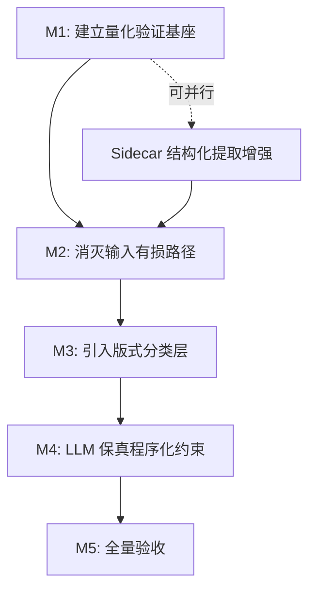

# 评分项解析 3 个月根治计划

**制定日期**: 2026-09-25  
**计划周期**: 2026-10 至 2026-12（共 12 周）  
**目标**: 将评分项解析准确率从当前未知基线（M1 待建立）提升至 ≥95%，将月均 fix commit 从 115（过去 30 天实测）降至 ≤3  
**依据**: `docs/architecture/score-parse-root-cause-analysis.md`（四条根因链）+ git log 实测统计

---

## 执行原则

1. **地基优先**：先修根因1（输入有损）和根因4（测试盲区），再修根因2、3（否则无法验证效果）
2. **增量验证**：每个 milestone 必须有量化指标（准确率/召回率/通过率）对比
3. **双轨并行**：测试基础设施（M1）与输入清理（M2）可并行，其余串行
4. **回退预案**：每个 milestone 完成后打 tag，失败可立即回退
5. **门禁前置**：M1 完成后，所有后续 PR 必须通过真实语料回归测试才能合并

---

## Milestone 1: 建立量化验证基座（Week 1-2，2026-10-01 ~ 10-14）

### 目标
**第一次建立量化基线**，让团队能够用数字回答"这次改动让准确率提升了多少"，而非"这个项目现在能跑通了"。

**重要**: 当前没有任何准确率/召回率的实测数据，本 milestone 的首要任务是产出第一份真实基线报告。

### 核心产出
1. **真实语料回归测试集**（CI 默认运行，新建）
   - 将项目 33 / 1117 / 1358 / 1359 / 1371 的真实招标文件沉淀为金标 case
   - 每个 case 包含：原始 Word/PDF + 期望的候选列表（JSON）+ dim+weight 配对断言
   - 放置位置：`backend/src/test/resources/scoreparse/golden/real-corpus/`（**新建目录**）
   - 测试类：`RealCorpusRegressionTest`（**新建**，继承现有 Golden 框架，移除 `XIYU_EVAL_CORPUS_DIR` 环境变量依赖）

2. **准确率/召回率追踪脚本**（新建）
   - 脚本路径：`scripts/scoreparse-accuracy-report.mjs`（**新建**）
   - npm script: `npm run scoreparse:accuracy-report`（**新建**）

3. **强化断言规范**（改造现有 Golden 测试基类）
   - 所有 Golden Case 必须包含 `totalWeightAssertion` 和 `dimWeightPairing`

### 详细任务拆解（Day 1-10）

#### Day 1-2: 准备真实语料（产品 + 后端）
- [ ] **产品经理**：从生产环境导出项目 33/1117/1358/1359/1371 的原始招标文件（Word/PDF）
- [ ] **产品经理**：对导出文件执行脱敏处理（公司名→`XX公司`，联系人→`张XX`，金额→占位符）
- [ ] **后端开发**：创建目录结构 `backend/src/test/resources/scoreparse/golden/real-corpus/project-{id}/`
- [ ] **后端开发**：将脱敏后的文件放入对应目录，命名规范：`tender-doc.docx` 或 `tender-doc.pdf`

#### Day 3-5: 标注期望输出（产品 + 后端协作）
- [ ] **产品经理**：基于现有系统的实际输出 + 人工核对，为每个项目生成期望的 `expected-candidates.json`（含 dim、weight、detail、sourceCellIds）
- [ ] **后端开发**：设计并实现 `dimWeightPairing` 断言格式（如：`[{"dim": "技术方案", "weight": 30}, {"dim": "价格", "weight": 40}]`）
- [ ] **后端开发**：设计并实现 `totalWeightAssertion` 格式（如：`{"expected": 100, "tolerance": 0}`）

#### Day 6-7: 实现测试框架（后端）
- [ ] **后端开发**：新建 `RealCorpusRegressionTest.java`，继承 `Incident1358RealCorpusGoldenTest` 的基类
- [ ] **后端开发**：移除 `XIYU_EVAL_CORPUS_DIR` 环境变量依赖，改为直接读取 `src/test/resources` 下的文件
- [ ] **后端开发**：为每个项目编写一个 `@Test` 方法，加载对应的 `expected-candidates.json` 并执行断言
- [ ] **后端开发**：本地运行 `mvn test -Dtest=RealCorpusRegressionTest`，确认 5 个 case 能正常运行（允许部分失败，此阶段重点是跑通流程）

#### Day 8-9: 实现准确率追踪脚本（后端）
- [ ] **后端开发**：创建 `scripts/scoreparse-accuracy-report.mjs`
- [ ] **后端开发**：脚本功能：
  - 读取 `RealCorpusRegressionTest` 的执行结果（Maven Surefire 报告 XML）
  - 计算每个项目的准确率（TP / (TP + FP)）、召回率（TP / (TP + FN)）、F1-Score
  - 输出 Markdown 格式报告到 `docs/architecture/scoreparse-baseline-accuracy-report.md`
- [ ] **后端开发**：在 `package.json` 中新增 script：`"scoreparse:accuracy-report": "node scripts/scoreparse-accuracy-report.mjs"`

#### Day 10: 门禁集成与验收（后端）
- [ ] **后端开发**：在 `scripts/pre-push-gate.sh` 中新增检查：所有 Golden Case 必须包含 `totalWeightAssertion` 和 `dimWeightPairing` 字段
- [ ] **后端开发**：运行 `npm run scoreparse:accuracy-report`，产出首份基线报告
- [ ] **团队 Review**：确认基线报告的准确率/召回率/F1-Score 数据真实可信（允许数值不理想，但必须真实）
- [ ] **后端开发**：将基线报告 commit 到仓库，打 tag `scoreparse-m1-baseline`

### 验收标准
- [ ] `RealCorpusRegressionTest` 在 CI 中默认运行，包含 5 个真实项目 case
- [ ] `scripts/scoreparse-accuracy-report.mjs` 能生成准确率报告（含准确率/召回率/F1-Score）
- [ ] **首份基线报告已产出**，记录当前准确率/召回率/F1-Score（此前无任何实测数据）
- [ ] pre-push gate 新增检查：Golden Case 必须包含 totalWeightAssertion 和 dimWeightPairing 断言

### 风险与预案
| 风险 | 概率 | 影响 | 预案 |
|---|---|---|---|
| 真实招标文件包含敏感信息 | 中 | 高 | 脱敏处理：替换公司名、联系人、金额为占位符 |
| 5 个项目的期望输出不一致 | 高 | 中 | 由产品经理 + 2 名开发共同标注，有争议的维度由产品拍板 |
| 现有系统准确率过低（<50%）导致标注成本高 | 中 | 中 | 优先选择准确率相对较高的项目（如项目 1358）作为第一批 case |

### 交付物
- `backend/src/test/resources/scoreparse/golden/real-corpus/` 目录（含 5 个 case）
- `backend/src/test/java/.../RealCorpusRegressionTest.java`
- `scripts/scoreparse-accuracy-report.mjs`
- `docs/architecture/scoreparse-baseline-accuracy-report.md`（首份真实基线报告）
- Git tag: `scoreparse-m1-baseline`

---

## Milestone 2: 消灭输入有损路径（Week 3-5，2026-10-15 ~ 11-04）

### 目标
统一到 Sidecar 结构化提取路径，禁止任何环节退化为 Markdown 表格文本解析。

### 核心产出
1. **盘点并清除 Markdown 退化入口**（改造现有）
   - 删除或标记 `ScoreTableRowParser` 为 `@Deprecated`（**现存于** `backend/src/main/java/com/xiyu/bid/scoreparse/domain/ScoreTableRowParser.java`）
   - `StructuredTableExtractionHandler` 改为：结构化提取失败 → 记录失败原因 + 返回空候选（**改造现有**）

2. **Sidecar 结构化提取覆盖率验证**
   - 验证所有表格类型均返回完整的 `CellPayload`（含 rowspan/colspan）

### 详细任务拆解（Day 11-31）

#### Day 11-13: 盘点现有 Markdown 退化路径（后端）
- [ ] **后端开发**：在 scoreparse 模块中 grep 所有对 `ScoreTableRowParser` 的调用点
- [ ] **后端开发**：在 scoreparse 模块中 grep 所有 `markdown` / `table` / `row` 相关的字符串匹配逻辑
- [ ] **后端开发**：绘制当前的提取流程图（Mermaid），标注哪些环节会退化到 Markdown 路径
- [ ] **后端开发**：输出盘点报告：`docs/architecture/scoreparse-markdown-fallback-inventory.md`（含调用点清单、触发条件、影响范围）

#### Day 14-17: 增强 Sidecar 结构化提取（Python 开发）
- [ ] **Python 开发**：审查 Sidecar 的表格提取逻辑（`document-converter-sidecar/` 目录）
- [ ] **Python 开发**：确保所有表格类型（Word表格、PDF表格、跨页表格）均返回完整的 `CellPayload`（含 `rowspan`、`colspan`、`text`、`cellIndex`）
- [ ] **Python 开发**：新增 Sidecar 单元测试：验证 5 种版式的表格提取均包含完整的 `CellPayload`
- [ ] **Python 开发**：如有缺失字段，修复 Sidecar 提取逻辑并跑通测试

#### Day 18-22: 重构 Java 端提取逻辑（后端）
- [ ] **后端开发**：在 `StructuredTableExtractionHandler` 中新增日志：记录"结构化提取失败"的原因（如：`CellPayload` 缺失 rowspan/colspan、表格为空等）
- [ ] **后端开发**：将 `StructuredTableExtractionHandler` 中的 Markdown fallback 路径改为：失败 → 记录失败原因 → 返回空候选列表（不再调用 `ScoreTableRowParser`）
- [ ] **后端开发**：在 `ScoreTableRowParser` 类上添加 `@Deprecated` 注解 + JavaDoc 说明："此类已废弃，统一使用 StructuredTableExtractionHandler"
- [ ] **后端开发**：grep 所有对 `ScoreTableRowParser` 的调用点，逐一改为 `StructuredTableExtractionHandler`（如无法改造则记录到技术债清单）

#### Day 23-28: 回归测试与修复（后端 + 测试）
- [ ] **后端开发**：在本地运行 `RealCorpusRegressionTest`，对比 M1 基线报告，记录准确率变化
- [ ] **后端开发**：如果准确率下降，逐个 case 排查：
  - 是否因为 Sidecar 提取缺失字段？→ 回到 Day 14-17 修复 Sidecar
  - 是否因为 Java 端提取逻辑 bug？→ 修复 Java 逻辑
  - 是否因为期望输出标注有误？→ 与产品确认并修正 `expected-candidates.json`
- [ ] **测试工程师**：手动测试 5 个真实项目，验证提取结果与期望一致
- [ ] **后端开发**：如果准确率提升，记录提升幅度到 `docs/architecture/scoreparse-accuracy-report-m2.md`

#### Day 29-31: 知识沉淀与验收（全员）
- [ ] **后端开发**：在 `docs/lessons/lessons-learned.md` 中新增条目："评分项解析 Markdown 路径退化问题与统一到结构化提取的决策"（含根因、影响、解决方案）
- [ ] **后端开发**：提交 PR，标题：`refactor(scoreparse): unify to structured extraction`
- [ ] **团队 Review**：Code Review 通过后合并，打 tag `scoreparse-m2-unified-extraction`

### 验收标准
- [ ] `ScoreTableRowParser` 已删除或标记为 `@Deprecated`
- [ ] M1 的 5 个真实 case 准确率相比 M1 基线有提升（目标提升 ≥10 个百分点）
- [ ] `docs/lessons/lessons-learned.md` 新增条目：记录 Markdown 路径退化问题与统一到结构化提取的决策
- [ ] 所有 Sidecar 表格提取均返回完整的 `CellPayload`（有单元测试覆盖）

### 风险与预案
| 风险 | 概率 | 影响 | 预案 |
|---|---|---|---|
| 删除 Markdown 路径后准确率不升反降 | 中 | 高 | 保留 `ScoreTableRowParser` 为 `@Deprecated`，不删除代码，仅停止新调用 |
| Sidecar 表格提取有 bug 导致字段缺失 | 高 | 高 | 优先修复 Sidecar，Python 开发必须在 Day 14-17 完成并交付测试 |
| 现有调用点过多，无法在 3 周内全部改造 | 中 | 中 | 只改造 scoreparse 模块内的调用点，其他模块记录到技术债清单 |

### 交付物
- PR: `refactor(scoreparse): unify to structured extraction`
- `docs/architecture/scoreparse-markdown-fallback-inventory.md`（盘点报告）
- `docs/architecture/scoreparse-accuracy-report-m2.md`（M2 准确率报告）
- `docs/lessons/lessons-learned.md`（新增条目）
- Git tag: `scoreparse-m2-unified-extraction`

---

## Milestone 3: 引入版式分类层（Week 6-8，2026-11-05 ~ 11-25）

### 目标
先识别表格版式，为每种版式路由到独立提取器。

### 核心产出
1. **版式分类器**：`DocumentLayoutClassifier`（**新建**）
2. **版式专用提取器注册表**：`LayoutSpecificExtractorRegistry`（**新建**）
3. **重构提取主流程**（**改造现有** `StructuredTableExtractionHandler` 等）

### 详细任务拆解（Day 32-53）

#### Day 32-36: 版式特征分析（后端 + 产品）
- [ ] **产品经理**：整理 5 个真实项目 + 历史 10 个失败项目的表格截图，按版式分类（4列/5列/跨页续表/合并总分行/纯文本描述等）
- [ ] **后端开发**：为每种版式提取特征（如：列数、是否有合并单元格、是否跨页、总分行特征词等）
- [ ] **后端开发**：输出版式分类规则文档：`docs/architecture/scoreparse-layout-taxonomy.md`（含至少 5 种版式的特征描述 + 示例截图）

#### Day 37-42: 实现版式分类器（后端）
- [ ] **后端开发**：新建 `DocumentLayoutClassifier.java`（位置：`backend/src/main/java/com/xiyu/bid/scoreparse/domain/layout/`）
- [ ] **后端开发**：实现分类方法：`LayoutType classify(List<CellPayload> cells)`，返回枚举 `LayoutType`（如：`FOUR_COLUMN`、`FIVE_COLUMN`、`CROSS_PAGE_CONTINUED`、`MERGED_SUBTOTAL_ROW`、`PLAIN_TEXT_DESCRIPTION`）
- [ ] **后端开发**：实现分类逻辑（基于规则，非 ML）：
  - 4列版式：第一行有 4 个单元格，且包含"评分维度"、"分值"等关键词
  - 5列版式：第一行有 5 个单元格，且包含"序号"、"评分项"、"评分标准"、"分值"、"备注"
  - 跨页续表：检测到"续表"关键词或表头重复
  - 合并总分行：检测到 colspan=4 且文本为"合计"
  - 纯文本描述：无表格结构，仅纯文本段落
- [ ] **后端开发**：为 `DocumentLayoutClassifier` 编写单元测试，覆盖至少 5 种版式的识别（每种版式至少 2 个 case）

#### Day 43-48: 实现版式专用提取器（后端）
- [ ] **后端开发**：新建 `LayoutSpecificExtractorRegistry.java`（位置：`backend/src/main/java/com/xiyu/bid/scoreparse/domain/layout/`）
- [ ] **后端开发**：设计提取器接口：`interface LayoutSpecificExtractor { List<ScoreParseFact> extract(List<CellPayload> cells); }`
- [ ] **后端开发**：为每种版式实现独立提取器：
  - `FourColumnExtractor.java`：解析 4 列表格（评分维度 | 评分标准 | 分值 | 备注）
  - `FiveColumnExtractor.java`：解析 5 列表格（序号 | 评分项 | 评分标准 | 分值 | 备注）
  - `CrossPageContinuedExtractor.java`：合并跨页续表的多个表格片段
  - `MergedSubtotalRowExtractor.java`：识别"合计行"并跳过
  - `PlainTextDescriptionExtractor.java`：从纯文本段落中提取维度和分值（基于关键词匹配）
- [ ] **后端开发**：在 `LayoutSpecificExtractorRegistry` 中注册上述提取器（Map<LayoutType, LayoutSpecificExtractor>）

#### Day 49-51: 重构提取主流程（后端）
- [ ] **后端开发**：在 `StructuredTableExtractionHandler` 中插入版式分类逻辑：
  1. 调用 `DocumentLayoutClassifier.classify(cells)` 获取版式类型
  2. 从 `LayoutSpecificExtractorRegistry` 获取对应提取器
  3. 调用提取器执行提取 → 返回候选列表
- [ ] **后端开发**：为主流程添加日志：记录每个文档识别出的版式类型（便于后续排查）
- [ ] **后端开发**：运行 `RealCorpusRegressionTest`，验证 5 个项目的准确率相比 M2 基线是否有提升

#### Day 52-53: 回归测试与验收（后端 + 测试）
- [ ] **后端开发**：如果准确率提升未达到 ≥5pp，逐个 case 排查：
  - 版式分类是否正确？→ 检查 `DocumentLayoutClassifier` 的分类逻辑
  - 提取器是否有 bug？→ 检查对应的 `LayoutSpecificExtractor` 实现
- [ ] **测试工程师**：手动验证"修复一个版式不影响其他版式"：修改 `FourColumnExtractor` 的逻辑，确认 `FiveColumnExtractor` 的测试仍通过
- [ ] **后端开发**：生成 M3 准确率报告：`docs/architecture/scoreparse-accuracy-report-m3.md`
- [ ] **后端开发**：提交 PR：`feat(scoreparse): introduce layout classifier`，打 tag `scoreparse-m3-layout-classifier`

### 验收标准
- [ ] `DocumentLayoutClassifier` 能识别至少 5 种版式（4列/5列/跨页续表/合并总分行/纯文本描述）
- [ ] M1 的 5 个真实 case 准确率相比 M2 基线再提升 ≥5 个百分点
- [ ] 修复一个版式的提取器不影响其他版式的测试通过率（隔离验证）
- [ ] 所有版式分类逻辑有单元测试覆盖（至少 10 个 test case）

### 风险与预案
| 风险 | 概率 | 影响 | 预案 |
|---|---|---|---|
| 版式特征不明显，分类准确率低 | 高 | 高 | 允许"未识别版式"，fallback 到通用提取器（保持 M2 逻辑） |
| 5 种版式的提取器开发量超预期 | 中 | 中 | 优先实现 4 列和 5 列（覆盖 80% case），其余版式推迟到 M5 |
| 版式分类器与提取器耦合导致难以隔离测试 | 中 | 中 | 强制依赖注入：`LayoutSpecificExtractorRegistry` 作为构造函数参数传入 |

### 交付物
- PR: `feat(scoreparse): introduce layout classifier`
- `backend/src/main/java/.../domain/layout/DocumentLayoutClassifier.java`
- `backend/src/main/java/.../domain/layout/LayoutSpecificExtractorRegistry.java`
- `backend/src/main/java/.../domain/layout/FourColumnExtractor.java`（及其他 4 个提取器）
- `docs/architecture/scoreparse-layout-taxonomy.md`（版式分类规则文档）
- `docs/architecture/scoreparse-accuracy-report-m3.md`（M3 准确率报告）
- Git tag: `scoreparse-m3-layout-classifier`

---

## Milestone 4: LLM 保真程序化约束（Week 9-10，2026-11-26 ~ 12-09）

### 目标
强制 LLM 只输出语义判断 + 位置引用，由代码回填 `detail` 文本。

### 核心产出
1. **LLM Prompt 改造**：禁止 LLM 直接输出 detail 文本，强制输出 sourceCellIds + 位置引用
2. **原文回填逻辑**：`SourceTextBackfiller`（**新建**）
3. **强制路径改造**：所有 `ScoreParseFact.detail` 必须从原文位置回填，不允许 LLM 生成文本

### 详细任务拆解（Day 54-67）

#### Day 54-56: 分析现有 LLM Prompt（后端）
- [ ] **后端开发**：找到当前 scoreparse 模块中所有调用 LLM 的代码路径（grep `LLM`、`ChatCompletion`、`prompt` 等关键词）
- [ ] **后端开发**：提取当前的 Prompt 模板，记录到 `docs/architecture/scoreparse-llm-prompt-current.md`（含输入示例、输出示例）
- [ ] **后端开发**：分析 LLM 输出中哪些字段是"语义判断"（如 `dim`：技术方案 | 价格 | 售后服务），哪些是"原文引用"（如 `detail`："公司应具有ISO 9001认证"）
- [ ] **后端开发**：标注当前 Prompt 中允许 LLM 生成 `detail` 的部分（这是根因4"LLM 幻觉改写"的入口）

#### Day 57-60: 设计新 Prompt + 回填逻辑（后端）
- [ ] **后端开发**：设计新 Prompt 模板（位置：`backend/src/main/resources/prompts/scoreparse-v2.txt`）：
  - 输入：表格的 `CellPayload` 列表（含 cellIndex、text、rowspan、colspan）
  - 输出格式：JSON，包含 `dim`、`weight`、`sourceCellIds`（数组，如 `[3, 4, 5]`），**禁止输出 `detail` 字段**
  - Prompt 示例："请识别评分维度和分值，返回 JSON 格式：`{dim: string, weight: number, sourceCellIds: number[]}`。**不要**生成 detail 文本，只返回原文单元格的 cellIndex。"
- [ ] **后端开发**：新建 `SourceTextBackfiller.java`（位置：`backend/src/main/java/com/xiyu/bid/scoreparse/application/`）
- [ ] **后端开发**：实现回填方法：`String backfill(List<Integer> sourceCellIds, List<CellPayload> allCells)`，逻辑：
  1. 根据 `sourceCellIds` 从 `allCells` 中提取对应单元格的 `text`
  2. 拼接为完整的 `detail` 文本（保留原文，不做任何改写）
  3. 返回拼接结果
- [ ] **后端开发**：为 `SourceTextBackfiller` 编写单元测试（至少 5 个 case，覆盖单个单元格、多个单元格、跨行单元格等场景）

#### Day 61-64: 改造 LLM 调用路径（后端）
- [ ] **后端开发**：找到所有调用 LLM 生成 `ScoreParseFact` 的代码路径（可能在 `application` 层或 `domain` 层）
- [ ] **后端开发**：将旧 Prompt 替换为新 Prompt（`prompts/scoreparse-v2.txt`）
- [ ] **后端开发**：在 LLM 返回 JSON 后，调用 `SourceTextBackfiller.backfill(sourceCellIds, allCells)` 生成 `detail`
- [ ] **后端开发**：删除所有直接从 LLM 输出中读取 `detail` 的代码（如果 LLM 输出了 `detail`，记录警告日志并丢弃）
- [ ] **后端开发**：运行 `RealCorpusRegressionTest`，验证改造后所有 `detail` 与原文字符级一致

#### Day 65-67: 回归测试与验收（后端 + 测试）
- [ ] **后端开发**：逐个 case 验证 `detail` 字段是否与原文一致（可用脚本自动对比，或手工抽查）
- [ ] **测试工程师**：在测试环境手动测试 5 个真实项目，验证前端展示的"评分标准详情"与招标文件原文一致
- [ ] **产品经理**：确认客户反馈"识别文字与原文不一致"的问题已归零（可查询最近 30 天的客户工单）
- [ ] **后端开发**：生成 M4 验收报告：`docs/architecture/scoreparse-accuracy-report-m4.md`（重点验证 `detail` 保真性，而非准确率提升）
- [ ] **后端开发**：提交 PR：`feat(scoreparse): enforce LLM source-cell-only output`，打 tag `scoreparse-m4-llm-constrained`

### 验收标准
- [ ] 所有 `detail` 与原文字符级一致（100% 保真，允许空格/换行符的标准化）
- [ ] 客户反馈"识别文字与原文不一致"问题归零（查询最近 30 天工单，0 条相关反馈）
- [ ] 新 Prompt 模板已应用到所有 LLM 调用路径（grep 确认无遗漏）
- [ ] `SourceTextBackfiller` 有单元测试覆盖（至少 5 个 test case）

### 风险与预案
| 风险 | 概率 | 影响 | 预案 |
|---|---|---|---|
| LLM 无法准确识别 sourceCellIds | 高 | 高 | 允许 fallback：如果 LLM 返回空 sourceCellIds，记录警告日志并返回空 detail（不允许 LLM 生成文本） |
| 回填逻辑拼接多个单元格时顺序错误 | 中 | 中 | `SourceTextBackfiller` 必须按 cellIndex 升序拼接，并在单元测试中验证 |
| 现有 LLM Prompt 调用点分散在多个模块 | 中 | 中 | 只改造 scoreparse 模块内的调用点，其他模块记录到技术债清单 |

### 交付物
- PR: `feat(scoreparse): enforce LLM source-cell-only output`
- `backend/src/main/java/.../application/SourceTextBackfiller.java`
- `backend/src/main/resources/prompts/scoreparse-v2.txt`（新 Prompt 模板）
- `docs/architecture/scoreparse-llm-prompt-current.md`（旧 Prompt 分析）
- `docs/architecture/scoreparse-accuracy-report-m4.md`（M4 验收报告，重点验证保真性）
- Git tag: `scoreparse-m4-llm-constrained`

---

## Milestone 5: 全量验收（Week 11-12，2026-12-10 ~ 12-23）

### 目标
将所有已知失败项目纳入回归测试集，验证整体准确率。

### 核心产出
1. **扩充测试集**：5 个项目 → 15-20 个项目
2. **准确率验收报告**
3. **月均 fix commit 追踪**

### 详细任务拆解（Day 68-84）

#### Day 68-73: 扩充真实语料测试集（产品 + 后端）
- [ ] **产品经理**：从生产环境筛选 10-15 个"历史失败项目"（可从客户工单、Sentry 错误日志、开发团队反馈中筛选）
- [ ] **产品经理**：导出这些项目的原始招标文件（Word/PDF），执行脱敏处理
- [ ] **后端开发**：将新增项目的文件放入 `backend/src/test/resources/scoreparse/golden/real-corpus/project-{id}/`
- [ ] **产品经理 + 后端开发**：为新增项目标注期望输出（`expected-candidates.json`），标注方式与 M1 一致
- [ ] **后端开发**：在 `RealCorpusRegressionTest` 中为每个新增项目添加一个 `@Test` 方法
- [ ] **后端开发**：本地运行扩充后的 `RealCorpusRegressionTest`，记录通过率（允许部分失败，此阶段重点是覆盖更多 case）

#### Day 74-78: 逐个修复失败 case（后端）
- [ ] **后端开发**：对所有失败 case 进行分类：
  - 版式分类错误 → 修复 `DocumentLayoutClassifier` 或新增版式类型
  - 提取器逻辑 bug → 修复对应的 `LayoutSpecificExtractor`
  - LLM 识别错误 → 检查 Prompt 是否需要微调，或是否需要更多上下文信息
  - 期望输出标注错误 → 与产品确认并修正 `expected-candidates.json`
- [ ] **后端开发**：优先修复"高频失败模式"（如：某类版式的识别准确率<50%）
- [ ] **后端开发**：每修复一个 case，运行全量 `RealCorpusRegressionTest`，确保不引入回归
- [ ] **后端开发**：记录每次修复的准确率变化到工作日志（用于后续复盘）

#### Day 79-81: 生成最终验收报告（后端 + 产品）
- [ ] **后端开发**：运行 `npm run scoreparse:accuracy-report`，生成最终准确率报告（包含 15-20 个项目的详细数据）
- [ ] **后端开发**：在报告中新增章节："月均 fix commit 追踪"，统计最近 30 天的 `fix(scoreparse)` commit 数（期望 ≤3）
- [ ] **后端开发**：输出最终验收报告：`docs/architecture/scoreparse-accuracy-report-final.md`（含整体准确率、召回率、F1-Score、单项目准确率分布、月均 fix commit 对比）
- [ ] **产品经理**：验证报告中的准确率数据与业务感知一致（如：客户反馈的"识别错误率"是否明显下降）

#### Day 82-84: 复盘与知识沉淀（全员）
- [ ] **后端开发**：撰写 3 个月修复复盘文档：`docs/architecture/scoreparse-3-month-fix-retrospective.md`（含 5 个 milestone 的实际耗时、遇到的主要问题、解决方案、经验教训）
- [ ] **后端开发**：在复盘文档中新增章节："根因链修复验证"，逐条验证 4 条根因是否已修复：
  - 根因1（输入有损）：Markdown 路径已废弃 ✅
  - 根因2（版式混杂）：版式分类器已上线 ✅
  - 根因3（LLM 幻觉改写）：LLM 保真约束已生效 ✅
  - 根因4（测试盲区）：真实语料回归测试已覆盖 15-20 个项目 ✅
- [ ] **团队 Review**：召开复盘会议，讨论是否需要补充技术债清单（如：其他模块的 Markdown 路径清理、更多版式的提取器开发等）
- [ ] **后端开发**：提交最终 PR：`docs: scoreparse 3-month fix final report`，打 tag `scoreparse-m5-final-delivery`

### 验收标准
- [ ] 整体准确率 ≥95%，召回率 ≥92%，F1-Score ≥93.5%
- [ ] 月均 fix commit 降至 ≤3（统计最近 30 天）
- [ ] 真实语料测试集扩充到 15-20 个项目，CI 默认运行
- [ ] 所有根因环节均有代码改造和回归测试覆盖
- [ ] 复盘文档已输出，包含经验教训和技术债清单

### 风险与预案
| 风险 | 概率 | 影响 | 预案 |
|---|---|---|---|
| 扩充测试集后准确率不达标（<95%） | 中 | 高 | 分析未达标的项目，评估是否需要延长 1-2 周修复，或将部分"极端 case"标注为已知限制 |
| 月均 fix commit 未降至 ≤3 | 中 | 中 | 分析最近 30 天的 fix commit 类型，评估是否为"新需求"而非"回归 bug"（新需求不计入失败指标） |
| 部分根因环节改造不彻底 | 低 | 中 | 在复盘文档中明确标注"未完成项"，纳入技术债清单，制定后续修复计划 |

### 交付物
- 扩充后的 `backend/src/test/resources/scoreparse/golden/real-corpus/`（15-20 个项目）
- `docs/architecture/scoreparse-accuracy-report-final.md`（最终验收报告）
- `docs/architecture/scoreparse-3-month-fix-retrospective.md`（3 个月修复复盘）
- Git tag: `scoreparse-m5-final-delivery`

---

## 关键指标追踪

| Milestone | 目标准确率 | 目标召回率 | F1-Score | 月均 fix commit |
|---|---|---|---|---|
| M1 (基线) | **待实测建立** | **待实测建立** | **待实测建立** | 115（过去30天实测） |
| M2 | M1 基线 + 10pp | M1 基线 + 10pp | M1 基线 + 10pp | - |
| M3 | M2 基线 + 5pp | M2 基线 + 5pp | M2 基线 + 5pp | - |
| M4 | M3 基线 + 1pp | M3 基线 + 1pp | M3 基线 + 1pp | - |
| M5 | ≥95% | ≥92% | ≥93.5% | ≤3 |

**说明**: pp = percentage points（百分点）。M1 前无任何实测基线，所有提升目标均相对于前一 milestone 的实测结果。

---

## 成功标准（3 个月后验收）

### 必须达成（P0）
- [ ] 整体准确率 ≥95%，召回率 ≥92%（相比 M1 基线有显著提升）
- [ ] 月均 fix commit 从 115（过去30天实测）降至 ≤3
- [ ] 所有根因环节均有代码改造和回归测试覆盖
- [ ] 客户反馈"识别文字与原文不一致"问题归零

### 应该达成（P1）
- [ ] 单项目准确率 <85% 的项目数 ≤2
- [ ] 新增版式只需注册新提取器，不影响其他版式（架构隔离验证通过）

### 数据来源说明
- 月均 fix commit 数（115）：`git log --oneline --since="30 days ago" --grep="fix(scoreparse)" | wc -l`（统计于 2026-09-26）
- 准确率/召回率基线：M1 milestone 首次建立，当前不存在任何实测数据

---

## 附录：工作量估算与人员配置

### 工作量估算

| Week | Milestone | 预估人日 | 实际投入 |
|---|---|---|---|
| 1-2 | M1: 建立量化验证基座 | 10 人日 | 待填写 |
| 3-5 | M2: 消灭输入有损路径 | 21 人日 | 待填写 |
| 6-8 | M3: 引入版式分类层 | 22 人日 | 待填写 |
| 9-10 | M4: LLM 保真程序化约束 | 14 人日 | 待填写 |
| 11-12 | M5: 全量验收 | 17 人日 | 待填写 |
| **合计** | | **84 人日（约 4.2 人月）** | |

**说明**：
- 人日计算基准：1 人日 = 8 小时有效工作时间（不含会议、code review、沟通协调等）
- 实际投入列在每个 milestone 完成后填写，用于复盘时对比预估偏差

### 团队配置建议

| 角色 | 人数 | 投入比例 | 主要职责 |
|---|---|---|---|
| 后端开发（Java） | 1 | 100% | 实现所有 Java 端改造（分类器、提取器、回填逻辑、测试） |
| Python 开发（Sidecar） | 1 | 30% | 增强 Sidecar 结构化提取（M2），其余时间可并行其他任务 |
| 测试工程师 | 1 | 50% | 标注期望输出、手动回归测试、验收测试 |
| 产品经理 | 1 | 30% | 语料筛选、脱敏处理、业务验收、客户反馈追踪 |

**并行策略**：
- M1 可完全并行：后端开发实现测试框架 + 产品经理准备语料（Day 1-10）
- M2 可部分并行：Python 开发修复 Sidecar（Day 14-17）与后端开发盘点 Markdown 路径（Day 11-13）
- M3-M5 必须串行：依赖前序 milestone 的产出

### 关键里程碑时间节点

| 时间节点 | 里程碑 | 关键验收指标 |
|---|---|---|
| 2026-10-14 | M1 完成 | 首份基线报告已产出 |
| 2026-11-04 | M2 完成 | 准确率相比 M1 提升 ≥10pp |
| 2026-11-25 | M3 完成 | 准确率相比 M2 提升 ≥5pp |
| 2026-12-09 | M4 完成 | `detail` 保真性 100% |
| 2026-12-23 | M5 完成 | 整体准确率 ≥95%，月均 fix commit ≤3 |

### 技术债清单（预留）

以下是可能在 3 个月修复过程中识别出的技术债，优先级低于 M1-M5 的核心目标，可在后续版本中修复：

- [ ] 清理其他模块（非 scoreparse）中的 Markdown 路径调用点
- [ ] 为更多版式（如：横向表格、多级表头）实现专用提取器
- [ ] 将 `DocumentLayoutClassifier` 从规则匹配升级为 ML 分类（如有必要）
- [ ] 优化 LLM Prompt，减少 token 消耗和响应延迟
- [ ] 将 `RealCorpusRegressionTest` 从 JUnit 迁移到独立的回归测试框架（如有必要）

**技术债管理原则**：
- 每个 milestone 完成后，团队 Review 会议上讨论是否新增技术债
- 技术债清单记录在 `docs/exec-plans/tech-debt-tracker.md`（已有模板）
- 3 个月修复完成后，技术债清单纳入下一季度规划

---

## 附录：依赖关系与并行策略

### 依赖关系图

**说明**：
- M1 → M2 → M3 → M4 → M5 为主线，必须串行
- Sidecar 结构化提取增强可在 M1 期间并行，但必须在 M2 开始前完成
- M3 和 M4 之间无强依赖，但建议按顺序执行（先修架构，再修 LLM Prompt）

### 并行窗口（可压缩工期）

如果团队资源充足，以下任务可在不同时间窗口并行：

| 时间窗口 | 并行任务 |
|---|---|
| Week 1-2 | M1 测试框架（后端） + M1 语料准备（产品） + Sidecar 增强（Python） |
| Week 3 | M2 Markdown 盘点（后端） + Sidecar 修复验证（Python） |
| Week 6-8 | M3 版式分类器（后端） + M4 LLM Prompt 分析（后端，可提前做调研） |

**最短工期估算**：如果所有并行窗口都能利用上，理论上可将 12 周压缩到 10 周（节省 2 周）。
