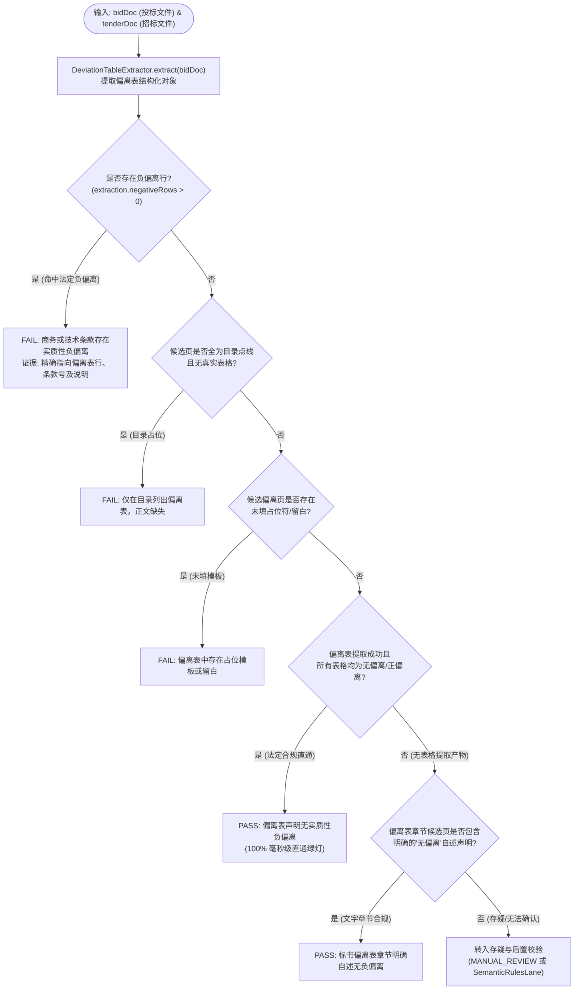

# 设计方案：响应性核查回归投标第一性原理 (RESPONSIVENESS_REVIEW Overhaul)

* **作者**：西域数智化投标研发团队
* **日期**：2026-10-31
* **状态**：已批准 / 待实施 (Approved / Ready for Implementation)

---

## 1. 概述 (Overview)

在西域数智化投标管理平台中，`RESPONSIVENESS_REVIEW`（响应性评审）是 25 项合规质检中的核心硬规则。其业务职责是审查投标文件是否满足招标文件的实质性商务与技术要求，防止因实质性负偏离导致废标。

然而，现行系统存在设计倒错：引擎试图在全标书正文中通过关键词匹配捕捉所谓的“自述负偏离”，直接导致了大量合规标书被严重误判为 `FAIL`（如把正文复述的合同违约解除条款误认为负偏离）。

本设计方案推动响应性核查**彻底回归招投标第一性原理**：
认定实质性响应与负偏离的**唯一法定事实源是投标人提交的《商务偏离表》和《技术偏离表》（含偏离表正文章节自述）**。方案彻底废除非偏离表正文全文扫词定罪的逻辑，将证据边界收敛至法定偏离表体系，确保规范填报偏离表的合规标书 100% 确定性亮绿灯直通（`PASS`）。

---

## 2. 核心问题陈述 (The Problem)

### 2.1 业务痛点：合规标书频遭误判，破坏系统可信度
在真实交付中（如项目 1388），投标人提交了 300+ 页的规范标书，偏离表中明确声明全部实质性响应、无任何负偏离。然而系统质检却被直接标红判定为实质性负偏离（`FAIL`），阻断交付流程。这导致一线业务人员对平台的“数智化”能力产生根本性怀疑。

### 2.2 技术致错机制：全文暴力扫词定罪
在 `ResponsivenessReviewPolicy.java` 第 72-85 行：
```java
// 4. 非表格形式明确自述实质性负偏离拦截（对齐全量 NEGATIVES 词表，排除表头选项说明）
for (DocumentContent.PageContent page : bidDoc.pages()) {
    for (String negKw : DeviationTableExtractor.NEGATIVES) {
        int index = findDeclaredNegative(page.text(), negKw);
        if (index < 0) continue;
        ...
        return QualityCheckItemResult.fail(...);
    }
}
```
该逻辑对标书全文遍历匹配 `NEGATIVES` 词表（`"负偏离", "不满足", "负偏差", "未满足", "部分响应", "部分满足", "低于"`）。
无论是在技术方案中出现的正常技术指标描述（“能耗低于国家标准”、“温度低于-10℃启动辅热”），还是合同条款中复述的违约解除情形（第 108 页“服务不满足甲方需求且整改无效的解除合同”），均被机械短路判定为 `FAIL`。

### 2.3 历史修补误区：治症状不治根因
前序修复 PR !2944（针对报告 147）仅增加了针对“不允许负偏差”和“负偏差是指”两类特定句式的正则过滤，使用 `masked.setCharAt` 空格掩码试图遮蔽命中句。由于没有消除“全文负词直接判 FAIL”的根本机制，在真实整文件回放中，误判点立刻从第 2 页转移到了第 108 页的合同违约条件上，且导致交付门禁不得不隔离 4 项已知缺陷测试。

---

## 3. 目标与非目标 (Goals & Non-Goals)

### 3.1 目标 (In-Scope Goals)
1. **法定事实源唯一化**：
   实质性负偏离的判定证据严格且仅限定为《商务偏离表》、《技术偏离表》提取出的负偏离行（`row.type() == NEGATIVE`）以及偏离表章节明确自述。
2. **彻底移除全局正文负词定罪逻辑**：
   删除 `ResponsivenessReviewPolicy` 中的 Step 4 全局正文扫词逻辑及相关脆弱的句式掩码黑魔法（`ResponsivenessRuleCitation`）。
3. **合规标书确定性亮绿灯直通 (PASS)**：
   对偏离表完整且无负偏离行（纯 `NONE` / `POSITIVE`）或自述无偏离的标书，100% 确定性输出 `QualityCheckStatus.PASS`，杜绝降级或误拦截。
4. **保留形式合规防护门禁**：
   保留既有的偏离表仅列目录点线占位拦截、偏离表内留白占位符未填拦截。
5. **真实环境双向闭环验收**：
   - 项目 1388 真实完整文档在测试环境重新核查不再被判定为 `FAIL`；
   - 偏离表中填入真实负偏离项的对照样本依然能 100% 精准拦截并输出规范证据。
6. **消除历史隔离测试缺陷**：
   解开并修复 `Report147ResponsivenessRegressionTest` 中被隔离的 4 个已知缺陷用例，全部转绿。

### 3.2 非目标 (Out-of-Scope Non-Goals)
1. **不修改其他 24 项合规核查**：严格限制在 `RESPONSIVENESS_REVIEW` 范围，不干扰资质、人员、价格等其他模块。
2. **不引入大模型全量阅读**：不新增全文 LLM 语义理解通道，保持纯 CPU 规则引擎的高并发与毫秒级确定性。
3. **不重构全局文档解析与通用分页引擎**：保持现有 `DocumentContent` 与解析映射，不在此任务修改底层分页算法。

---

## 4. 技术方案 (Technical Plan)

### 4.1 核心架构与判定数据流 (Architecture & Flow)

响应性审查将严格执行**单向流水线与纯核心函数式契约（FP-Java）**。整个审查过程不包含任何 I/O、不依赖外部服务、不改变传入文档状态。



### 4.2 消除的坏代码与组件重塑

#### 1. 彻底删除全局正文扫词定罪 (Step 4 彻底移除)
- **删除位置**：`ResponsivenessReviewPolicy.java` 第 72-85 行。
- **废弃辅助代码**：
  - `findDeclaredNegative(String text, String negKw)`
  - `hasNegationPrefix(String text, int kwStart)`
  - `isHeaderChoiceOption(String text, int kwStart, int kwLen)`
- **效果**：直接拔除导致第 2 页规则说明与第 108 页合同违约条款误报的根本源头，正文出现的任何“不满足”、“低于”等词不再具有触发 FAIL 的权限。

#### 2. 退役 `ResponsivenessRuleCitation.java` 空格掩码黑魔法
- **现状缺陷**：为给特定句式打补丁，PR !2944 引入了 `ResponsivenessRuleCitation`，在 `StringBuilder` 中用空格逐字遮蔽命中句子，再重新调用 `ResponsivenessReviewPolicy.check(filtered)`，最后又费力反向查找还原原始证据引用。这属于典型的过度工程（Anti-pattern）。
- **重构方案**：既然正文扫词已彻底废除，正文中的规则说明再也不会误触发负偏离拦截，因此全文正则扫描、空格遮蔽及反向文本还原代码直接退役。
- **简化职责**：仅保留纯静态辅助方法 `negativeRowEvidence(...)`，用于直接将 `DeviationRow` 组装为标准 `QualityEvidence`。

#### 3. 强化偏离表提取器 `DeviationTableExtractor.java`
- 作为全系统拦截实质性负偏离的法定唯一防线，保持并巩固其多格式提取能力：
  - **Markdown 表格提取**：解析 `| 条款 | 招标要求 | 投标响应 | 偏离说明 |` 格式。
  - **制表符 TAB 分隔纯文本提取**：兼容上游 Word/PDF 转换生成的无边框纯文本表格行。
  - **偏离类型严格归一**：精准识别 `NONE`（无偏离/完全响应）、`NEGATIVE`（负偏离/负偏差/不满足/部分响应）、`POSITIVE`（正偏离/优于）、`UNKNOWN`（存疑）。

### 4.3 核心类设计与契约约束 (FP-Java Invariants)

| 类名 | 角色与职责 | 代码约束与契约 |
| :--- | :--- | :--- |
| `ResponsivenessReviewPolicy.java` | 响应性核查主策略 (Pure Policy) | 纯核心函数式类，严禁包含任何 I/O、网络、数据库调用；重构后总行数从 294 行压缩至 180 行以内，严格受控于 300 行预算。 |
| `DeviationTableExtractor.java` | 偏离表与偏离行纯数据提取器 | 纯函数式解析器，输入 `DocumentContent`，输出不可变 `DeviationExtraction` 记录。 |
| `ResponsivenessRuleCitation.java` | 偏离证据格式化器 | 剥离所有字符串篡改与掩码逻辑，仅保留标准证据构造函数。 |

---

## 5. 替代方案权衡 (Alternatives Considered)

在确定回归招投标第一性原理之前，团队深入推演并权衡了以下三种技术路线，均因存在显著缺陷被明确否决：

### 5.1 替代方案一：基于主体词（“我司/我方”）与句法依存过滤正文关键词
* **方案描述**：保留正文关键词扫描机制，但在命中“不满足”等词时，进一步分析句子主语是否为投标人自身（例如判断是否包含“我方”、“我司”、“本单位”），或判断是否属于条件假设从句（如包含“若出现...则解除合同”）。
* **否决原因**：
  1. **违背业务第一性原理**：在真实投标中，评标专家绝不会在几百页正文里去推敲某句话是不是投标人自述的偏离，正文根本不是法定偏离声明的发生地。
  2. **语法规则高度脆弱**：中文标书大量存在无主语句、倒装句、长难从句及 OCR 转换造成的断句瑕疵，机械的语法分析极易在长尾样本中失效，不可避免地引发二次误判或严重漏判。
  3. **违反极简设计原则**：引入复杂的句法分析将显著增加纯策略核心的复杂度，违背代码预算与可维护性要求。

### 5.2 替代方案二：继续扩充关键词豁免与规则句式白名单（补丁路线）
* **方案描述**：沿袭 PR !2944 的修补思路，在 `ResponsivenessRuleCitation` 中增加对“合同解除”、“不构成违约”、“整改无效”等合同条件的正则表达式豁免，继续用空格掩码进行局部遮蔽。
* **否决原因**：
  1. **铁证如山的失败模式（追症状不追根因）**：PR !2944 仅排除了两类句式，误判就立刻从第 2 页转移到第 108 页；若继续为第 108 页打补丁，误报只会继续向后文的其他合同条款转移，陷入永无休止的“打地鼠”循环。
  2. **代码严重退化**：通过在内存字符串中逐字打空格（`masked.setCharAt`）并反向还原证据引用的做法属于典型代码异味（Code Smell），破坏了核心策略的清晰性与健壮性。

### 5.3 替代方案三：将响应性核查全面迁移至大语言模型（LLM）
* **方案描述**：彻底放弃 Java 规则引擎的确定性裁决，将整本标书通过提示词交由大模型进行端到端语义阅读与负偏离提取。
* **否决原因**：
  1. **SLA 与延迟无法承受**：真实标书长达数百页、几十万字，全量送入 LLM 需消耗海量 Token，且单次核查耗时将长达数十秒甚至分钟级，无法满足并发质检的性能需求。
  2. **合规确定性缺失（零幻觉容忍）**：负偏离核查直接关乎投标人的废标风险，具有极其严肃的法律合规性。大模型的随机性与概率输出无法保证 100% 幂等，无法作为严肃的合规门禁。

---

## 6. 详细实施计划 (Detailed Implementation)

本节明确实施过程中所涉及的全部文件、修改动因、执行顺序与验证门禁。任何实施动作必须严格遵循 TDD（测试先行）与原子提交纪律。

### 6.1 受影响文件清单与修改动因 (File Modifications)

| 文件路径 | 操作 | 修改动因与职责 |
| :--- | :--- | :--- |
| `backend/src/main/java/com/xiyu/bid/compliance/domain/policy/ResponsivenessReviewPolicy.java` | 修改 | **核心策略净化**：彻底删除第 72-85 行的全局正文 `NEGATIVES` 遍历循环，删除 `findDeclaredNegative`、`hasNegationPrefix`、`isHeaderChoiceOption` 等辅助方法。调整流程使无负偏离行的合规标书直接输出 `PASS`。文件代码行数从 294 行压缩至约 180 行，重回健康预算空间。 |
| `backend/src/main/java/com/xiyu/bid/compliance/domain/policy/ResponsivenessRuleCitation.java` | 修改 | **解构黑魔法**：废除句子级正则扫描与内存字符串打空格遮蔽（`masked.setCharAt`）逻辑；仅保留不可变偏离证据构造方法（`negativeRowEvidence`）。 |
| `backend/src/test/java/com/xiyu/bid/compliance/domain/policy/Report147ResponsivenessRegressionTest.java` | 修改 | **解除历史缺陷隔离**：移除 4 个历史妥协用例上的 `@EnabledIfSystemProperty` 隔离注解，将历史妥协断言（断言为 `MANUAL_REVIEW` 或 `FAIL`）直接升级为符合第一性原理的断言（`assertThat(result.status()).isEqualTo(QualityCheckStatus.PASS)`）。 |
| `backend/src/test/java/com/xiyu/bid/compliance/domain/policy/ResponsivenessReviewPolicyTest.java` | 修改 | **根因行为测试扩展**：新增无隔离的纯核心测试用例，覆盖：<br/>1. 真实合同解除条件（第 108 页样本）+ 偏离表无偏离，断言 `PASS`；<br/>2. 真实合同解除条件 + 偏离表含实质性负偏离行，断言 `FAIL` 且证据精准指向表格行；<br/>3. 仅在正文出现技术指标负词（如“能耗低于国家标准”）不触发任何误判。 |
| `docs/lessons/lessons-learned.md` | 修改 | **工程教训与 RCA 沉淀**：追加记录响应性核查从“句式补丁”彻底进化为“第一性原理法定事实收敛”的经典复盘案例，警示后续开发严禁在业务正文中搞全局词法暴力匹配。 |

### 6.2 统一实施步骤清单 (Step-by-Step Execution Sequence)

1. **第一阶段：TDD 行为基准建立（Red 阶段）**
   - 在 `ResponsivenessReviewPolicyTest.java` 中引入包含项目 1388 合同违约解除条款（第 108 页文本）及无偏离偏离表的测试夹具。
   - 在当前基线运行测试，确认因命中了第 73 行的正文扫词而产生预期的 `FAIL` 失败（确立无隔离的真实 RED）。
2. **第二阶段：纯策略核心重构（Green 阶段）**
   - 修改 `ResponsivenessReviewPolicy.java`，剥离全局扫描与辅助正则过滤。
   - 简化 `ResponsivenessRuleCitation.java`，移除遮蔽与反向还原逻辑。
   - 运行新单测，确认测试用例转绿。
3. **第三阶段：解除 4 项历史缺陷隔离并升级断言**
   - 打开 `Report147ResponsivenessRegressionTest.java`，移除 4 个用例的隔离开关。
   - 修正断言预期为合规 `PASS`，运行全套回归用例，确保 15 项用例全部无条件转绿。
4. **第四阶段：全量合规模块回归验证**
   - 执行 `mvn -f backend/pom.xml '-Dtest=com.xiyu.bid.compliance.**.*Test' test`，确保合规域内全部既有单元测试与金标回放 100% 通过。
5. **第五阶段：双向验收与门禁自检**
   - **正向验证**：使用项目 1388 完整转换产物（包含第 2 页规则与第 108 页合同解除条件）进行端到端输入回放，验证输出为 `PASS`。
   - **负向对照**：在同一输入中注入合法的偏离表负偏离行，验证系统准确输出 `FAIL` 且证据精准锚定偏离表行号。
   - 运行项目门禁脚本 `bash scripts/pre-commit.sh` 确保无代码风格、行数预算或静态分析违规。
6. **第六阶段：知识沉淀与 Wiki 回填**
   - 将本次根因分析、七大根因对照与架构收敛经验回填至 `docs/lessons/lessons-learned.md`。
