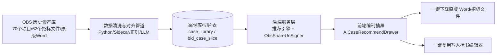

# 历史标书切片与案例库融合实现方案

> **文档定位**：近期开发计划与实施方案  
> **创建日期**：2026-08-20  
> **状态**：Draft / 待执行  
> **所属模块**：案例库（Casework）/ AI 智能推荐 / OBS 对象存储资产融合  

---

## 1. 背景与业务价值

### 1.1 业务痛点与契机
在投标文件编制阶段，编制人员常需根据招标文件的各项评分标准（如“售后服务承诺”、“技术架构设计”、“应急保障预案”等）撰写针对性应答文本。目前存在以下痛点：
1. **应答素材匮乏**：新建案例库面临冷启动问题，缺少足量经过实战检验的高质量技术/商务应答片段；
2. **历史资产沉睡**：早期沉淀在华为云 OBS 上的 70 个 2026 年度真实历史投标项目（包含 8,144 个章节切片及对应完整原版标书）未与在线系统深度打通；
3. **原脱机切片的局限性**：原先脱机切片仅有应答正文，缺少对应的“招标评分要求原文”，且无法跳转下载原始完整 Word 文档。

### 1.2 资产勘探与突破性发现
经过对测试环境与 OBS 对象存储挂载目录（`/data/obs_winbid/2026年（投标文件）`）的全量扫描与深度排查：
- **覆盖率**：全部 **70 个历史项目** 中，有 **62 个项目（占比 88.6%）** 在 OBS 对应目录中完整保留了**招标文件**（涵盖 `.docx` 103 个、`.pdf` 88 个、`.xlsx` 50 个、专用格式 40+ 个）；
- **原版文件完好**：每个项目均包含完整的原始投标文件 Word（`.docx`）与招标文件（`.docx`/`.pdf`）；
- **结论**：**原脱机切片的局限性可被彻底消除**。通过将 OBS 招标文件要求、应答切片正文、OBS 原版文档下载链接三者有机对齐，可瞬间为系统注入 8,000+ 篇“有招标要求、有应答正文、可一键下载原版 Word、可一键复用”的全要素标书案例素材库。

---

## 2. 核心方案设计与用户体验闭环

### 2.1 用户端核心体验
1. **语义精准推荐**：在标书编制阶段选择某一评分项（如“系统高可用方案”），系统基于 `ScoreItem.detail` 自动从 8,000+ 切片中召回高契合度案例；
2. **招标要求 ↔ 投标应答精准对照**：卡片与详情弹窗中清晰展示“历史招标原始要求”与“我方应答正文”，匹配逻辑一目了然；
3. **历史来源标识与溯源**：明确标记 `[历史标书切片库]` 标签与来源项目名称（如“2026年中国建设银行龙集采项目”）；
4. **原版完整标书一键下载**：卡片提供「下载招标文件」与「下载完整投标文件 Word」按钮，后端动态生成 5 分钟有效期的 OBS 安全签名下载链接；
5. **一键复用与章节追加**：点击「一键复用」，可选择当前标书的目标章节，支持追加或覆盖，保持编辑器撤销闭环。

---

## 3. 数据模型与服务设计

### 3.1 数据表字段扩展（Flyway 迁移）

在案例库相关表（`case_library` / `bid_case_slice`）中扩充以下核心字段：

| 字段名 | 类型 | 说明 | 示例值 |
|---|---|---|---|
| `is_historical_slice` | `TINYINT(1)` | 历史切片标识（默认为 1） | `1` |
| `source_project_name` | `VARCHAR(255)` | 来源历史项目名称 | `2026.01.20--中国建设银行` |
| `requirement_raw` | `LONGTEXT` | 对齐提取的招标原始要求文本 | `要求提供 7x24 小时应急响应机制，同城双活架构...` |
| `obs_bid_file_key` | `VARCHAR(512)` | 投标文件在 OBS 上的 ObjectKey/相对路径 | `2026年（投标文件）/2026.01.20--中国建设银行/...docx` |
| `obs_tender_file_key` | `VARCHAR(512)` | 招标文件在 OBS 上的 ObjectKey/相对路径 | `2026年（投标文件）/2026.01.20--中国建设银行/招标文件/...pdf` |
| `docx_label` | `VARCHAR(64)` | 切片类别（技术/商务/报价/其他） | `技术` |
| `section_level` | `INT` | 章节层级（H1/H2/H3） | `2` |
| `para_count` | `INT` | 段落数量 | `6` |
| `status` | `VARCHAR(32)` | 状态 | `ACTIVE` |

### 3.2 OBS 安全下载服务设计
- 后端复用成熟的 `ObsShareUrlSigner` 服务；
- 暴露安全接口 `GET /api/cases/{caseId}/download-url?fileType=BID|TENDER`；
- 后端根据 `obs_bid_file_key` / `obs_tender_file_key` 生成带过期时间（默认 300 秒）的预签名 URL，安全可控，避免长期外链泄露。

---

## 4. 详细工作量评估 (WBS)

总工期评估：**约 5.0 ~ 6.5 人天**。

| 阶段 / 模块 | 核心工作内容 | 涉及文件 / 工具 | 预估工时 |
|---|---|---|---|
| **Phase 1：数据提取与对齐管道** | 1. 编写批量解析脚本，提取 62 个项目招标文件的章节与评分条款 2. 运行语义/章节匹配算法，将 8,000+ 应答切片与招标条款建立对齐（填充 `requirement_raw`） 3. 提取并记录每个切片对应的 OBS 源文件路径（`bid_doc_key` / `tender_doc_key`） 4. 生成全量结构化导入数据（SQL/JSONL） | `scripts/slice_all_v9.py` `Sidecar/MarkItDown` `Python 3` | **1.5 ~ 2.0 人天** |
| **Phase 2：后端模型与服务层** | 1. 案例表结构扩展（增加 `requirement_raw`、`obs_bid_key`、`obs_tender_key`、`is_historical_slice` 等字段及 Flyway 迁移） 2. 接入 `ObsShareUrlSigner`，提供案例源文件安全临时下载链接 API 3. 案例推荐与搜索接口适配（支持关键词搜索 + 评分项语义匹配 + 历史案例过滤） | `V1xxx__update_case_library.sql` `ObsShareUrlSigner.java` `CaseSearchAppService.java` `AICaseRecommendController.java` | **1.5 ~ 2.0 人天** |
| **Phase 3：前端抽屉与交互增强** | 1. 推荐卡片 `AICaseRecommendCard.vue` 增加 `[历史标书]` 标签与原始招标要求展示 2. 详情弹窗 `AICaseDetailModal.vue` 增加「下载原版 Word」「下载招标文件」按钮与签名链接触发 3. 全局案例库页面（`CaseGrid.vue`）增加“历史切片库”分类筛选与检索 | `AICaseRecommendDrawer.vue` `AICaseRecommendCard.vue` `AICaseDetailModal.vue` `CaseGrid.vue` | **1.0 ~ 1.5 人天** |
| **Phase 4：数据导入与全链路验证** | 1. 执行数据库批量导入与向量化（Embedding 批量计算入库） 2. 端到端链路验证（OBS 下载有效性、检索延迟 <300ms、一键复用写入编辑器） 3. 单元测试、门禁检查与回归验证 | `local-ci.sh` `Pre-push gate` `E2E specs` | **1.0 人天** |
| **合计** | **端到端完整交付** | — | **约 5.0 ~ 6.5 人天** |

---

## 5. 交付路线建议：两阶段推进

### 阶段一：敏捷上线版（MVP，约 2 ~ 2.5 人天）
- **策略**：直接导入已有的 8,144 条应答切片，打上 `[历史标书切片库]` 标签，挂接 OBS 上对应的**原版完整投标文件 Word + 招标文件下载链接**，暂不做细粒度条款级逐句对齐。
- **效益**：
  - 2 天内快速上线，编制人员即可通过关键词/评分项检索到海量应答材料并一键复用；
  - 需要查阅上下文时，点击即可直接下载原版完整 Word 文档。

### 阶段二：全要素深度对齐版（追加 3.0 ~ 4.0 人天）
- **策略**：运行大模型/启发式解析，将 62 个招标文件的评分条款细化抽取，逐条对齐回填到 `requirement_raw` 中，实现“招标要求 ↔ 投标应答”细粒度逐条对照显示。

---

## 6. 风险评估与技术保障

1. **OBS 签名链接时效与安全性**：
   - *控制措施*：前端禁止使用长期静态 URL，统一通过后端临时授权生成 5 分钟有效签名的 OBS 链接。
2. **大批量数据入库与检索性能**：
   - *控制措施*：8,000+ 数据量在 MySQL 8.0 属于轻量级，建立 `(is_historical_slice, docx_label, project_dir)` 组合索引，单次分页检索控制在 50ms 以内。
3. **原版文档编码与特殊格式兼容**：
   - *控制措施*：对于 `.etbp` 等专有招投标格式，标记为“专有客户端格式下载”，`.docx`/`.pdf` 正常提供标准下载与在线预览。
