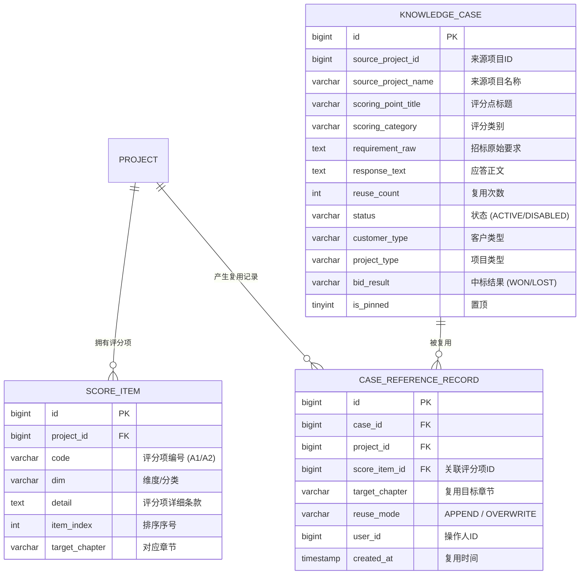

# Data Model: AI 智能推荐案例（Feature 046）

## 1. 实体关系图 (ER Diagram)



## 2. 数据库表变更设计 (Flyway Migration V1193)

为支持评分项级别的精准复用追溯，在 `case_reference_record` 表中补充 `score_item_id` 字段并建立索引：

```sql
-- V1193: 为 case_reference_record 增加 score_item_id 字段
ALTER TABLE case_reference_record
    ADD COLUMN score_item_id BIGINT NULL COMMENT '关联的评分项ID',
    ADD COLUMN reuse_mode VARCHAR(20) NULL DEFAULT 'APPEND' COMMENT '复用模式: APPEND/OVERWRITE',
    ADD INDEX idx_case_ref_score_item (score_item_id);
```

## 3. DTO 模型

### 3.1 CaseRecommendationRequest
```json
{
  "projectId": 1001,
  "scoreItemId": 2045,
  "keyword": "应急预案",
  "page": 0,
  "size": 10
}
```

### 3.2 CaseRecommendationResponse
```json
{
  "total": 12,
  "items": [
    {
      "id": 1001,
      "scoringTitle": "技术方案完整性",
      "scoringPointTitle": "应急响应体系与演练预案",
      "scoringCategory": "技术方案",
      "matchScore": 92,
      "matchLabel": "优质",
      "matchReasons": ["评分项要求高度匹配", "中标案例", "客户类型一致"],
      "matchedItems": ["应急响应", "7x24小时", "演练预案"],
      "requirementRaw": "投标人须具备完善的应急响应体系...",
      "responseText": "我方建立五级应急响应机制...",
      "responseTextSummary": "建立7x24应急团队...",
      "sourceProjectId": 8801,
      "sourceProjectName": "某集团2025年度信息化建设项目",
      "bidResult": "WON",
      "reuseCount": 18
    }
  ]
}
```
