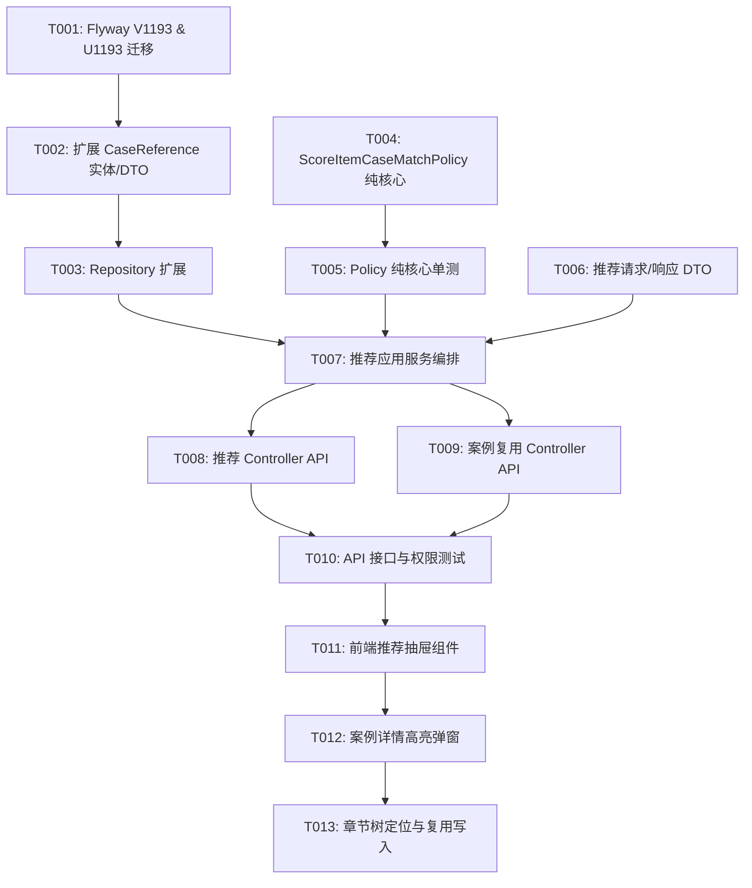

# Tasks: AI 智能推荐案例（Feature 046）

**Input**: Design documents from `/specs/046-ai-case-recommendation/`  
**Prerequisites**: `spec.md`, `plan.md`, `research.md`, `data-model.md`, `contracts/api-contract.md`

## 任务概览与依赖关系

---

## Phase 1: 数据底座与迁移 (Data Layer - Priority: P1)

- [x] **T001** `[P1]` `[US1]` 创建 Flyway 迁移脚本与回滚脚本  
  - 路径：`backend/src/main/resources/db/migration-mysql/V1193__add_score_item_to_case_reference.sql`  
  - 路径：`backend/src/main/resources/db/migration-mysql/U1193__add_score_item_to_case_reference.sql`  
  - 内容：为 `case_reference_record` 添加 `score_item_id`、`reuse_mode` 字段及索引。
- [x] **T002** `[P1]` `[US1]` 扩展 `CaseReferenceRecord` 实体与 DTO  
  - 路径：`backend/src/main/java/com/xiyu/bid/casework/entity/CaseReferenceRecord.java`  
  - 路径：`backend/src/main/java/com/xiyu/bid/casework/dto/CaseReferenceRecordDTO.java`  
  - 路径：`backend/src/main/java/com/xiyu/bid/casework/dto/CaseReferenceRecordCreateRequest.java`  
- [x] **T003** `[P1]` `[US1]` 扩展 `CaseReferenceRecordRepository` 数据访问方法  
  - 路径：`backend/src/main/java/com/xiyu/bid/casework/repository/CaseReferenceRecordRepository.java`  
  - 支持按 `scoreItemId` 与 `projectId` 查询复用记录。

---

## Phase 2: 评分项级推荐纯核心策略 (FP-Java Domain Policy - Priority: P1)

- [x] **T004** `[P1]` `[US2]` 实现 `ScoreItemCaseMatchPolicy` 纯核心匹配策略  
  - 路径：`backend/src/main/java/com/xiyu/bid/casework/domain/policy/ScoreItemCaseMatchPolicy.java`  
  - 职责：无 Spring 依赖，输入 `ScoreItemContext`（含 `code`, `dim`, `detail`）与候选案例列表，基于条款分词匹配、类别一致性、项目/客户类型一致性、中标加成计算 0~100 分综合得分并提取高亮关键词。
- [x] **T005** `[P1]` `[US2]` 编写 `ScoreItemCaseMatchPolicyTest` 单元测试  
  - 路径：`backend/src/test/java/com/xiyu/bid/casework/domain/policy/ScoreItemCaseMatchPolicyTest.java`  
  - 覆盖场景：满分命中、空 detail 降级、部分关键词匹配、非中标案例对比、综合评级断言。

---

## Phase 3: 推荐应用服务与接口编排 (Application & API Layer - Priority: P1 & P2)

- [x] **T006** `[P1]` `[US2]` 创建推荐请求与响应 DTO  
  - 路径：`backend/src/main/java/com/xiyu/bid/casework/dto/ScoreItemCaseRecommendRequest.java`  
  - 路径：`backend/src/main/java/com/xiyu/bid/casework/dto/ScoreItemCaseRecommendResponse.java`  
- [x] **T007** `[P1]` `[US2]` 实现 `ScoreItemCaseRecommendAppService` 应用服务  
  - 路径：`backend/src/main/java/com/xiyu/bid/casework/application/service/ScoreItemCaseRecommendAppService.java`  
  - 职责：权限守卫校验、加载 `ScoreItem` 详细条款、读取 `KnowledgeCase` 候选集、调用纯核心 Policy 计算并组装分页响应。
- [x] **T008** `[P1]` `[US2]` 暴露 `POST /api/projects/{projectId}/cases/recommend` 接口  
  - 路径：`backend/src/main/java/com/xiyu/bid/casework/controller/ScoreItemCaseRecommendController.java`  
  - 支持 `@PreAuthorize` 鉴权与参数校验。
- [x] **T009** `[P2]` `[US3]` 实现 `POST /api/cases/{id}/reuse` 案例复用与计数接口  
  - 路径：`backend/src/main/java/com/xiyu/bid/casework/controller/KnowledgeCaseController.java`  
  - 路径：`backend/src/main/java/com/xiyu/bid/casework/application/service/KnowledgeCaseCommandAppService.java`  
  - 路径：`backend/src/main/java/com/xiyu/bid/casework/application/service/CaseReferenceAppService.java`  
  - 实现数据库原子自增 `reuse_count` 并持久化复用日志。
- [x] **T010** `[P1]` `[US2/US3]` 编写 API 集成测试与权限测试  
  - 路径：`backend/src/test/java/com/xiyu/bid/casework/controller/ScoreItemCaseRecommendControllerTest.java`  
  - 路径：`backend/src/test/java/com/xiyu/bid/casework/application/service/ScoreItemCaseRecommendAppServiceTest.java`  

---

## Phase 4: 前端抽屉与文档编辑器闭环 (UI & Editor Integration - Priority: P3)

- [x] **T011** `[P3]` `[US4]` 封装「AI 智能推荐案例」抽屉组件  
  - 路径：`src/views/Bidding/components/AICaseRecommendDrawer.vue`  
  - 功能：联动当前项目评分项下拉框、支持关键词即时过滤、展示卡片与匹配度徽标。
- [x] **T012** `[P3]` `[US4]` 封装案例详情对比弹窗  
  - 路径：`src/views/Bidding/components/AICaseDetailModal.vue`  
  - 功能：查看应答原文、招标原始要求、高亮匹配点。
- [x] **T013** `[P3]` `[US4]` 对接标书章节树定位与复用写入  
  - 路径：`src/views/Bidding/components/AICaseReuseSectionModal.vue`  
  - 功能：选择目标章节、追加/覆盖模式切换、触发富文本编辑器写入与撤销能力。

---

## Phase 5: 规格收敛与 PRD 细节对齐 (Convergence & PRD Alignment)

- [x] **T014** `[P1]` 提供 `GET /api/projects/{projectId}/score-items` 契约端点  
  - 路径：`backend/src/main/java/com/xiyu/bid/casework/controller/ScoreItemCaseRecommendController.java`  
  - 作用：完全对齐 PRD 4.2 接口命名规范，并提供单元测试验证。
- [x] **T015** `[P1]` 推荐入参兼容 `scoreItemCode` 评分项编码查找  
  - 路径：`backend/src/main/java/com/xiyu/bid/casework/application/service/ScoreItemCaseRecommendAppService.java`  
  - 路径：`backend/src/main/java/com/xiyu/bid/casework/dto/ScoreItemCaseRecommendRequest.java`  
  - 作用：支持通过 "A1"、"B2" 等编码字符串直接触发细粒度匹配。
- [x] **T016** `[P2]` 抽屉无评分项数据时的警告与「前往解析」引导交互  
  - 路径：`src/views/Bidding/components/AICaseRecommendDrawer.vue`  
  - 作用：对齐 PRD 5.1 异常处理机制。
- [x] **T017** `[P2]` 抽屉尺寸调整为 680px 并添加加载文字  
  - 路径：`src/views/Bidding/components/AICaseRecommendDrawer.vue`  
  - 作用：对齐 PRD 3.7 & 6 抽屉规格与 "AI 正在根据评分项要素匹配案例..." 动效文字。
- [x] **T018** `[P2]` 案例详情弹窗增强元数据表格与视口高度约束  
  - 路径：`src/views/Bidding/components/AICaseDetailModal.vue`  
  - 作用：对齐 PRD 3.6 结构化描述表格（项目类型/客户类型/结果/招标主体等）与需求/应答区块高度限制。
