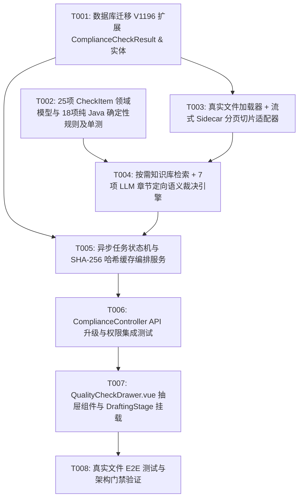

# Tasks: AI 标书质量核查（Feature 047 - 优化版）

**Input**: Design documents from `/specs/047-ai-bid-quality-check/`  
**Prerequisites**: `spec.md`, `plan.md`

## 优化后任务概览与依赖关系

---

## 阶段任务清单（8 个高内聚原子任务）

### Phase 1: 数据底座升级与单表统一架构 (Priority: P0)

- [x] **T001** `[P0]` `[US4]` 编写 Flyway V1196 迁移脚本与回滚脚本，扩展 `ComplianceCheckResult` 实体与 Repository  
  - 迁移路径：`backend/src/main/resources/db/migration-mysql/V1196__extend_compliance_check_results_for_quality.sql`  
  - 回滚路径：`backend/src/main/resources/db/rollback/migration-mysql/U1196__extend_compliance_check_results_for_quality.sql`  
  - 实体路径：`backend/src/main/java/com/xiyu/bid/compliance/entity/ComplianceCheckResult.java`  
  - 仓库路径：`backend/src/main/java/com/xiyu/bid/compliance/repository/ComplianceCheckResultRepository.java`  
  - 变更内容：
    - 为 `compliance_check_results` 扩展 `task_id` (UUID)、`status` (`INIT`/`PARSING`/`CHECKING`/`COMPLETED`/`FAILED`)、`progress` (0-100)、`current_step`、`error_message`、`bid_file_hash`、`tender_file_hash`、`bid_file_name`、`passed_count`、`failed_count`、`manual_review_count` 字段及联合哈希索引；
    - 废弃多余的独立 Task/Report 双表设计，使用单表统一承载任务流转与 25 项 Evidence 最终报告。

---

### Phase 2: 25 项领域模型与 18 项纯 Java 确定性规则 (Priority: P0)

- [x] **T002** `[P0]` `[US2]` 建立 25 项标准化枚举、Evidence 领域模型与纯函数式确定性规则策略及单测  
  - 路径：`backend/src/main/java/com/xiyu/bid/compliance/domain/BidQualityCheckItem.java`  
  - 路径：`backend/src/main/java/com/xiyu/bid/compliance/domain/QualityCheckCategory.java`  
  - 路径：`backend/src/main/java/com/xiyu/bid/compliance/domain/QualityCheckStatus.java`  
  - 路径：`backend/src/main/java/com/xiyu/bid/compliance/domain/QualityEvidence.java`  
  - 路径：`backend/src/main/java/com/xiyu/bid/compliance/domain/QualityCheckItemResult.java`  
  - 策略路径：`backend/src/main/java/com/xiyu/bid/compliance/domain/policy/DeterministicCheckPolicy.java`  
  - 单测路径：`backend/src/test/java/com/xiyu/bid/compliance/domain/policy/DeterministicCheckPolicyTest.java`  
  - 变更内容：
    - 定义 3 大类 25 项标准 CheckItem 与严重等级（`CRITICAL`/`HIGH`/`MEDIUM`）；
    - 纯 Java 零框架依赖实现前置 18 项确定性规则（大写金额转换匹配算法、货币单位、签章检测、敏感词正则扫描、工期响应比对、5项附件清单存在性校验）；
    - 编写 100% 内存单元测试，验证正例、金额错误、敏感词命中与附件缺失场景。

---

### Phase 3: 真实文件加载与流式 Sidecar 分页切片提取 (Priority: P0)

- [x] **T003** `[P0]` `[US1]` 重构 `ComplianceTargetLoader` 并实现流式 Sidecar 适配器与分页切片映射  
  - 路径：`backend/src/main/java/com/xiyu/bid/compliance/service/ComplianceTargetLoader.java`  
  - 路径：`backend/src/main/java/com/xiyu/bid/compliance/service/SidecarStreamDocumentAdapter.java`  
  - 变更内容：
    - `ComplianceTargetLoader` 废弃字符串拼接，从 `project_documents` 表根据 `projectId` 查询 `documentCategory = 'BID'` 与 `category = 'TENDER'` 加载真实文件；
    - 对齐 Spec 045 流式规范，基于 Java 21 `HttpClient` + `BodyPublishers.ofFile` 磁盘临时文件流式上传（避免 GB 级文件 OOM）；
    - 保留换页符（`\f`），构建包含 `pageNumber`、`rawText` 的 `PageContent` 分页切片映射表，确保证据链中的页码物理准确。

---

### Phase 4: 按需知识库检索与 7 项 LLM 语义裁决引擎 (Priority: P0)

- [x] **T004** `[P0]` `[US3]` 实现按需定向知识库检索与 7 项关键语义条款定向切片裁决引擎  
  - 路径：`backend/src/main/java/com/xiyu/bid/compliance/service/KnowledgeBaseOnDemandLoader.java`  
  - 路径：`backend/src/main/java/com/xiyu/bid/compliance/domain/policy/BidDocumentQualityEngine.java`  
  - 单测路径：`backend/src/test/java/com/xiyu/bid/compliance/domain/policy/BidDocumentQualityEngineTest.java`  
  - 变更内容：
    - 拒绝全量 dump 5 大库，改为根据招标文件资质/人员关键词按需定向检索企业知识库（资质库、人员库、业绩库、品牌授权库、仓库库）；
    - 拒绝长文全量送 LLM，仅对剩余 7 项深度语义条款（一票否决语义匹配、前附表关键条款偏离、评分项支撑等）提取对应章节切片送入 LLM 语义判定；
    - 汇总 18 项确定性规则与 7 项 AI 判定，生成全局统一的 25 项 `QualityCheckItemResult` 与结构化 `QualityEvidence`。

---

### Phase 5: 异步任务状态机与 SHA-256 哈希缓存防抖 (Priority: P1)

- [x] **T005** `[P1]` `[US4]` 实现异步调度器与应用编排服务  
  - 路径：`backend/src/main/java/com/xiyu/bid/compliance/application/BidQualityCheckAsyncExecutor.java`  
  - 路径：`backend/src/main/java/com/xiyu/bid/compliance/application/BidQualityCheckTaskAppService.java`  
  - 单测路径：`backend/src/test/java/com/xiyu/bid/compliance/application/BidQualityCheckTaskAppServiceTest.java`  
  - 变更内容：
    - `@Async("complianceTaskExecutor")` 负责后台文件下载、解析、按需比对与单表进度推进（`INIT` -> `PARSING` -> `CHECKING` -> `COMPLETED`/`FAILED`）；
    - 实现基于 `bidFileHash + tenderFileHash` 的 SHA-256 哈希防抖缓存复用，支持 `force=true` 强制重跑；
    - 完善任务超时扫描与异常熔断保护。

---

### Phase 6: 控制器路由升级与鉴权测试 (Priority: P1)

- [x] **T006** `[P1]` `[US4]` 升级 `ComplianceController` REST API 与权限集成测试  
  - 路径：`backend/src/main/java/com/xiyu/bid/compliance/controller/ComplianceController.java`  
  - 路径：`backend/src/main/java/com/xiyu/bid/compliance/dto/QualityCheckTaskDTO.java`  
  - 路径：`backend/src/main/java/com/xiyu/bid/compliance/dto/QualityCheckReportDTO.java`  
  - 测试路径：`backend/src/test/java/com/xiyu/bid/compliance/controller/ComplianceControllerTest.java`  
  - 变更内容：
    - 暴露标准异步接口：`POST /api/compliance/bid-quality/trigger/{projectId}`、`GET /api/compliance/bid-quality/progress/{taskId}`、`GET /api/compliance/bid-quality/report/{projectId}`；
    - 保持已有接口 `POST /api/compliance/bid-document/check/{projectId}` 向后兼容；
    - 使用 `@PreAuthorize("isAuthenticated()")` 与项目权限守卫，编写 MockMvc 单元与集成测试。

---

### Phase 7: 前端抽屉 UI 重构与交互联调 (Priority: P1)

- [x] **T007** `[P1]` `[US5]` 开发 `QualityCheckDrawer.vue` 抽屉组件并在 `DraftingStage.vue` 中对接  
  - 抽屉组件：`src/views/Project/stages/components/QualityCheckDrawer.vue`  
  - 页面挂载：`src/views/Project/stages/DraftingStage.vue`  
  - API 模块：`src/api/modules/ai/compliance.js`  
  - 变更内容：
    - 使用 `el-drawer` (宽度 880px) 替代 `QualityCheckDialog.vue`；
    - 抽屉头部：状态徽标、文件名、核查时间、3 大统计看板（通过数/不通过数/待人工确认数）；
    - 25 项分类卡片列表：按「基本信息（10）」、「分项合规（10）」、「附件清单（5）」折叠展示与严重级别标签；
    - 证据链对比面板：展开展示招标文件页码摘录 ↔ 投标文件物理页码原文 ↔ 知识库对照；
    - 异步进度条：2s 轮询与 120s 超时友好提示；
    - 重新核查二次确认：`ElMessageBox.confirm` 防误触。

---

### Phase 8: 门禁与真实 E2E 验证 (Priority: P0)

- [x] **T008** `[P0]` `[US1-US5]` 完善 Playwright E2E 测试并执行全量门禁  
  - 测试路径：`e2e/bid-document-quality-check.spec.js`  
  - 变更内容：
    - 去除无意义的 `test.skip()`，真实验证按钮点击、抽屉平滑滑出、25项卡片与证据详情展开、重新核查确认流程；
    - 运行 `npm run test:unit` 与 `bash scripts/pre-commit.sh`，确保 Flyway 校验、ArchUnit 架构规则与代码规范全部通过。
