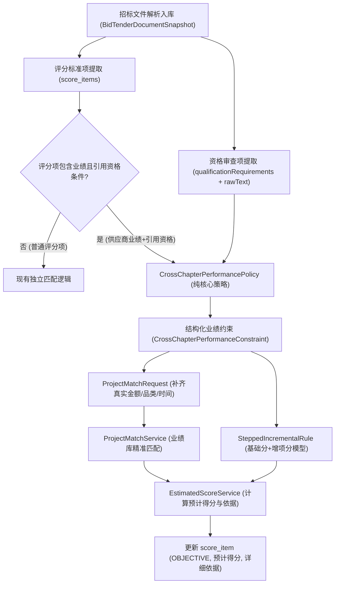

# Implementation Plan: 080 评分项跨章节穿透资格项业绩检索与精准匹配

**Branch**: `agent/codex/qual-perf-matching`  
**Spec**: `specs/080-qualification-performance-cross-matching/spec.md`

## 1. 架构总览与模块协作

## 2. 核心设计与改造点

### 2.1 沉淀共享纯核心策略：`CrossChapterPerformancePolicy`
- **位置**：`backend/src/main/java/com/xiyu/bid/scoreparse/domain/policy/CrossChapterPerformancePolicy.java`
- **职责**：
  1. 识别评分项是否引用资格条件（如：`满足资格条件`、`符合资格审查要求`、`资格条款规定`、`初步评审合格`）；
  2. 从标书资格项清单与资格审查章节中，定向提取实质性业绩要求（利用已有的 `QualificationClauseCollector` 逻辑进行下沉抽取）；
  3. 结构化解析出：签约时间门槛、单笔合同金额下限（如 1000 万元）、业务品类（如 MRO、工业品、办公耗材）、客户资质要求（央企/大型集团）以及必需凭据（发票、合同原件）。

### 2.2 升级阶梯计分策略：`IncrementalCountScorePolicy` / `SteppedScorePolicy`
- **现有缺陷**：`ZERO_SCORE_BASE` 只认初始为 0 分（`不得分`），遇到“满足资格条件的业绩得基础分60分，每增加一个加20分，满分100分”直接返回 empty，且被误判为主观项。
- **改造点**：
  - 支持 `BASE_AND_INCREMENT` 模式：
    - 正则识别：`得基础分\s*(\d+)分` + `每增加\s*(\d+)个.{0,20}?加\s*(\d+)分` + `满分\s*(\d+)分`；
    - 计算公式：
      - 合格数 = 0: 0 分；
      - 合格数 = 1: 基础分 60（占满分 60%）；
      - 合格数 ≥ 2: 基础分 60 + (合格数 - 1) * 20，封顶 100 分；
      - 按评分项权重 `weight`（如 5 分）折算：`itemWeight * (currentScore / 100)`。
  - 在 `ScoreTypeClassificationPolicy` 中注册该阶梯模式，直接判定为 `OBJECTIVE`。

### 2.3 改造编排层 `EstimatedScoreService`
- 在 `EstimatedScoreService` 中：
  - 引入 `TenderQualificationQueryPort`（或标书快照查询端口）；
  - 当处理 `CATEGORY_PROJECT` 且评分项引用资格条件时，调用 `CrossChapterPerformancePolicy` 获得穿透约束；
  - 将穿透出的品类关键词、金额下限、签约时间合并入 `ProjectMatchRequest`；
  - 若命中有效约束，调用 `ProjectMatchService.match`；
  - 组装可读的穿透依据文本（如：`引用资格审查第3条业绩门槛：单项合同≥1000万元、工业品类；业绩库匹配命中3个合同，按基础分60+递增40得满分`）。

## 3. 测试与验证策略 (TDD)

1. **纯策略单测 (Unit Tests)**：
   - `CrossChapterPerformancePolicyTest`：覆盖引用资格条件识别、金额品类穿透提取、纯噪音过滤；
   - `IncrementalCountScorePolicyTest`：覆盖基础分 60 分 + 每增加一个加 20 分的判定与算分；
   - `ScoreTypeClassificationPolicyTest`：验证当前截图中的真实条款被准确分类为 `OBJECTIVE`。
2. **编排集成测试 (Integration Test)**：
   - 模拟标书快照（含资格项业绩门槛）与当前评分项，验证 `EstimatedScoreService` 能够自动穿透并计算预计得分。
3. **黄金用例回归 (Golden Case Regression)**：
   - 固化本用例为 `case-production-cross-chapter-perf.json`，确保项目 22、项目 1117、项目 1382 及本真实用例长期稳定通过。
